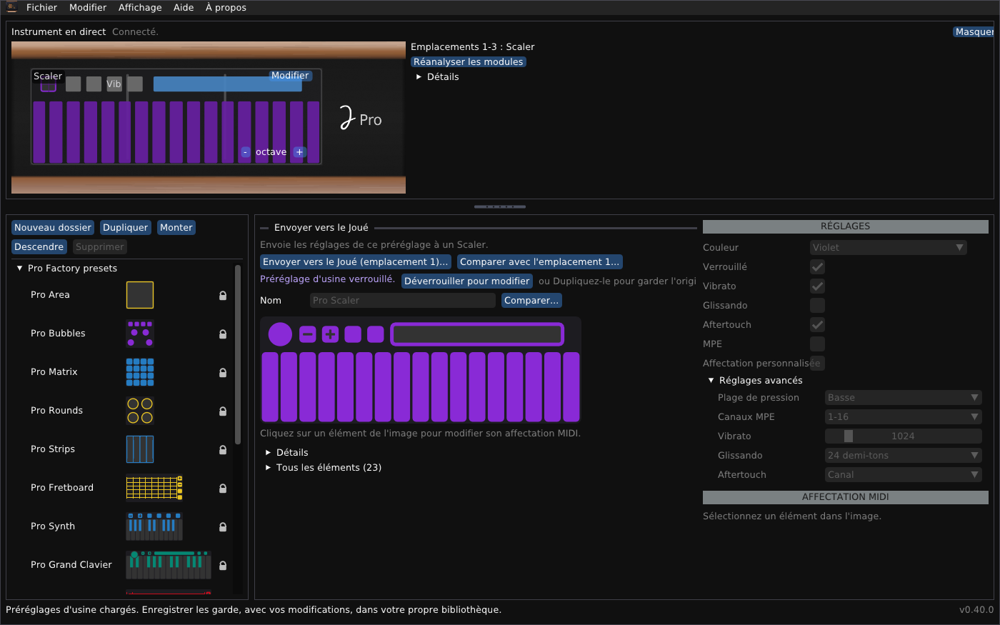

# Joué Editor Revival

*[English](README.md) · Français*

Un éditeur indépendant et multiplateforme pour l'instrument Joué, pour les jours où l'éditeur d'origine ne fonctionne plus (ce qui est déjà le cas sous Windows 11).

Joué Revival lit et modifie les bibliothèques de préréglages de l'éditeur Joué d'origine, montre l'instrument en direct (quel module est dans quel emplacement, où vous touchez), modifie les réglages des modules de l'instrument et les lui envoie, et contient un concepteur de modules pour dessiner de nouvelles dispositions, les imprimer à la taille réelle, ou les écrire sur une puce.



## En bref

- **Éditeur :** `cpp/app` est un programme Dear ImGui en C++17 ; `cpp/core` est le moteur (transfert MIDI/SysEx, dispositions de modules, fichiers de bibliothèque).
- **Matériel testé :** un Joué Pro (identifiant matériel 2, micrologiciel 1.11 build 80) avec les modules Matrix, Grand Clavier, Scaler et Grand Fretboard.
- **Plateformes :** utilisé et testé sous Windows 11 et sur un Mac Apple silicon. La version Linux n'est pas testée avec un instrument.
- **Langues :** l'interface et les documents sont en anglais et en français.
- **Non affilié :** il n'est ni fabriqué, ni approuvé, ni soutenu par Joué. Utilisez l'éditeur à vos risques. Il ne touche pas au micrologiciel du Joué et ne le fera jamais. Je ne veux pas être responsable de la mise hors service des instruments.

> [!WARNING]
> **Envoyer des réglages écrit dans la puce d'un module.** La disposition précédente du module est d'abord sauvegardée dans un fichier et peut être restaurée.
> Écrire une disposition sur une puce vierge, effacer une puce et la disposition temporaire sont nouveaux et n'ont été essayés que sur
> très peu de puces NTAG216 : essayez d'abord avec une seule puce, les autres modules retirés de l'instrument.

## Installer une version

Téléchargez le paquet de votre système depuis la page des versions (les paquets sont construits par GitHub Actions pour chaque version). Chaque paquet contient ce README, le [Guide de l'utilisateur](docs/user-guide.fr.md) et le [Guide du concepteur de modules](docs/module-designer.fr.md), en anglais et en français.

### Windows

Lancez `joue-revival-windows-x64-setup.exe` pour l'installer (une entrée dans le menu Démarrer et un désinstallateur), ou utilisez le zip :

1. Décompressez tout le paquet dans un dossier.
2. Lancez `JoueRevival.exe`. Si SmartScreen signale un éditeur inconnu (le fichier n'est pas signé), choisissez **Informations complémentaires**, puis **Exécuter quand même**.
3. Si certaines zones de la fenêtre sont dessinées en noir, lancez plutôt `JoueRevival-safe-graphics.bat`.

Dans les deux cas, votre bibliothèque et ses sauvegardes sont gardées dans `%APPDATA%\JoueEditorNG` ; le zip n'écrit rien d'autre en dehors de son propre dossier.

### macOS (Apple silicon)

Ouvrez `joue-revival-macos-arm64.dmg` et glissez l'application dans Applications, ou utilisez le zip :

1. Décompressez le paquet.
2. Dans le Terminal : `xattr -cr "Joue Revival.app"`, puis ouvrez l'application. (L'application est signée « ad hoc », non notariée ; un clic droit dessus puis **Ouvrir** fonctionne aussi.)
3. Sur un Mac Intel, compilez depuis les sources (ci-dessous).

### Linux

Téléchargez `joue-revival-linux-x86_64.AppImage`, rendez-le exécutable (`chmod +x joue-revival-linux-x86_64.AppImage`) et lancez-le ; ou décompressez `joue-revival-linux-x86_64.tar.gz` et lancez `joue_editor`. Il faut X11 ou XWayland, OpenGL et ALSA, qu'un poste de bureau a. Pour le compiler vous-même, voir ci-dessous, puis lancez `build/joue_editor`, ou exécutez `./joue-editor.sh`, qui compile d'abord si nécessaire.

### Premiers pas (tous les systèmes)

1. **Quittez l'éditeur Joué d'origine.** Il garde les ports MIDI de l'instrument.
2. Branchez le Joué en USB. Le panneau **Instrument en direct**, en haut, indique *Connecté* et montre les modules des trois emplacements.
3. Les préréglages d'usine (`presets/factoryLibrary.xml`, fournis ici) se chargent tout seuls la première fois. **Fichier > Ouvrir...** ouvre une autre bibliothèque, et **Enregistrer** garde la vôtre.

## Ce que vous pouvez faire avec l'éditeur Joué Revival

- **Parcourir et modifier des bibliothèques :** les préréglages d'usine (chargés au premier démarrage ; verrouillés, et non supprimables), vos propres dossiers et copies, enregistrés avec une sauvegarde du fichier précédent.
- **Voir l'instrument en direct :** les modules dans les emplacements, les contacts, l'octave des touches ; **toucher pour sélectionner**, qui sélectionne dans l'éditeur l'élément sur lequel est votre doigt ; **Réanalyser les modules** et un journal de détection quand quelque chose semble faux.
- **Modifier un module de l'instrument :** l'Action des boutons et des pads, les notes, les gammes (23 de l'original et 47 autres), la bulle, le contrôle Y, la plage de pression, le MPE et l'aftertouch ; puis envoyer les modifications, ou restaurer l'original. Un module qui a une disposition personnalisée s'ouvre à la place dans le concepteur de modules.
- **Envoyer un préréglage à un module** du même type, avec la liste de ce qui va changer ; **comparer** deux préréglages, ou un préréglage avec le module de l'instrument, sans rien écrire.
- **Informations sur l'appareil :** matériel, micrologiciel, numéros de série et ports, à copier pour l'assistance.
- **Aide :** un démarrage rapide (F1) avec une bienvenue au premier démarrage, et une vérification discrète d'une version plus récente (désactivable).
- **Concevoir une disposition :** pads, touches, bandes, cordes et zones avec des gestes de souris (rectangle de sélection, Ctrl + glisser pour déplacer, Maj + glisser pour redimensionner), dans une fenêtre qui peut sortir de la fenêtre principale ; grilles de pads, claviers, grilles isomorphes et manches comme modèles ; aligner, répartir, retourner et répéter ; les paramètres des modules du fabricant (plage de pression, MPE et ses canaux, aftertouch, contrôle Y) ; le vibrato et le glissando du module ; des boutons avec les Actions du fabricant (vibrato, sustain, choix du canal, bending, contrôle Y, aftertouch, glissando, fretless, octave) ; l'imprimer à la taille réelle ; l'essayer sur l'instrument comme disposition temporaire ; l'écrire sur une puce NTAG216 vierge (une puce neuve compte comme vierge) ; effacer une puce qui contient une disposition personnalisée. Voir le [Guide du concepteur de modules](docs/module-designer.fr.md).

Voir le [Guide de l'utilisateur](docs/user-guide.fr.md) pour les fenêtres, les fichiers et le dépannage. L'interface est en anglais ou en français (**Affichage > Language / Langue**) ; les documents sont dans les deux langues : [README.md](README.md), [User guide](docs/user-guide.md), [Module designer guide](docs/module-designer.md).

## Compiler depuis les sources (pour utilisateurs avancés)

Il faut CMake 3.20 ou plus récent, un compilateur C++17 et git. La première configuration télécharge pugixml, GLFW et Dear ImGui depuis GitHub : une connexion réseau est donc nécessaire. Une version courte pour chaque système suit ; le [Guide de développement](docs/development.md) (en anglais) donne les détails.

### Windows

Le programme Windows a jusqu'ici été compilé avec MinGW-w64, en compilation croisée sous Linux, et lancé sous Wine et sous Windows 11. Le workflow de publication le compile avec MSYS2 sur une machine Windows, avec les étapes ci-dessous ; cela n'a pas encore tourné, et compiler à la main sous Windows n'a pas été testé.

Avec [MSYS2](https://www.msys2.org), dans **MSYS2 MinGW 64-bit** :

```sh
pacman -S --needed mingw-w64-x86_64-toolchain mingw-w64-x86_64-cmake mingw-w64-x86_64-ninja git
cmake -S cpp -B build -G Ninja
cmake --build build
build/joue_editor.exe
```

Avec Visual Studio 2022 (charge de travail C++ et CMake) : `cmake -S cpp -B build -G "Visual Studio 17 2022" -A x64`, puis `cmake --build build --config Release` ; le programme est `build\Release\joue_editor.exe`. `Joue Editor.bat` fait la même chose et lance le programme.

### macOS

Installez les outils en ligne de commande de Xcode (`xcode-select --install`) et CMake (`brew install cmake`), puis :

```sh
cmake -S cpp -B build -DCMAKE_BUILD_TYPE=Release
cmake --build build -j 4
build/joue_editor
```

Un double-clic sur `Joue Editor.command` compile à la première utilisation et lance le programme.

### Linux

Sous Debian ou Ubuntu :

```sh
sudo apt install build-essential cmake git libx11-dev libxrandr-dev libxinerama-dev libxcursor-dev libxi-dev libgl-dev libasound2-dev
cmake -S cpp -B build -DCMAKE_BUILD_TYPE=Release
cmake --build build -j "$(nproc)"
build/joue_editor
```

La fenêtre utilise X11 (elle fonctionne sous XWayland, pas dans une session Wayland pure). Le MIDI utilise ALSA ; sans `libasound2-dev` le programme se compile mais ne peut pas parler à l'instrument.


## Limites importantes

- **L'écriture sur les puces est peu testée.** Les envois vers un Scaler, et l'écriture d'une disposition sur une puce NTAG216 vierge puis sa relecture, ont fonctionné sur l'instrument de l'auteur ; effacer une puce et la disposition temporaire n'ont été essayés que sur très peu de puces.
- **Le Synth et les modules Play** sont vérifiés d'après les modèles Play officiels et les dispositions d'usine de l'encodeur d'origine, pas sur un vrai module.
- **La détection des modules** dépend de ce que la carte annonce. Une lecture d'un emplacement peut renvoyer le module d'un autre ; le programme vérifie le type, et **Réanalyser les modules** et le journal de détection aident quand cela semble toujours faux.
- **Sous Windows, le partage des ports MIDI** dépend du système : si un autre programme (un moniteur MIDI) perd les notes, désactivez **Affichage > Écouter le port Play**.
- **macOS :** l'application n'est pas notariée, et seul Apple silicon est publié.
- **Linux :** non testé avec un instrument.

## Licence et crédits

Joué Revival est un logiciel libre sous **licence publique générale GNU v3 ou ultérieure** : voir [LICENSE](LICENSE). Copyright (C) 2026 Simon Bourdareau. Il est fourni sans aucune garantie.

Les préréglages d'usine de `presets/` viennent de l'application du fabricant : ils sont inclus pour que le programme fonctionne tout de suite, et ils ne sont pas couverts par la GPL.

Le protocole et les formats viennent de la rétro-ingénierie de l'éditeur Windows (.NET décompilé) et de l'éditeur macOS, des images du micrologiciel, et du projet libre [J-Play](https://github.com/Pjoooo/jplay-opensource) (Pascal Joguet, GPL-3.0). Dear ImGui, GLFW, pugixml et stb_image sont utilisés sous leurs propres licences.

La publication de cet éditeur a été réalisée avec l'autorisation de Pascal Joguet. Je l'ai contacté par e-mail afin de m'assurer que je ne porterais pas atteinte aux droits de propriété intellectuelle appartenant à Joue Music ou à toute autre entité. Pascal propose également une version en ligne de l'éditeur original, qui sera bientôt disponible.

Auteur : Simon Bourdareau.
