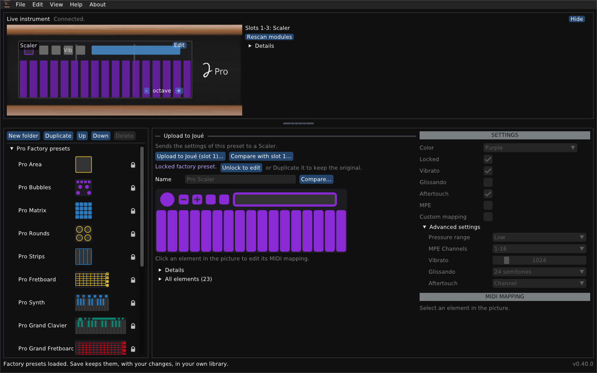

# Joué Editor Revival

*English · [Français](README.fr.md)*

An independent, cross-platform editor for the Joué instrument, for the days when the original editor no longer runs (which is already the case for Windows 11).

Joué Revival reads and edits the preset libraries of the original Joué Editor, shows the instrument live (which module is in which slot, where you touch it), edits the settings of the modules in the instrument and uploads them. The editor has a module designer to draw new layouts, then print them at real size, and put them on a NFC tag.



## At a glance

- **Editor:** `cpp/app` is a Dear ImGui program in C++17; `cpp/core` is the engine (MIDI/SysEx transfer, module layouts, library files).
- **Tested hardware:** a Joué Pro (hardware id 2, firmware 1.11 build 80) with the Matrix, Grand Clavier, Scaler and Grand Fretboard modules.
- **Platforms:** used and tested on Windows 11 and on an Apple-silicon Mac. The Linux build is not tested with an instrument.
- **Languages:** the interface and the documents are in English and in French.
- **Not affiliated:** It is not made, endorsed or supported by Joué. Use the editor at your own risk. It does not touch Joué firmware and never will. I do not want to be responsible for bricking the instruments.

> [!WARNING]
> **Uploading writes to the tag of a module.** The module's previous layout is saved as a file first and can be restored.
> Writing a layout to a blank tag, erasing a tag and the temporary layout are new and have been tried on very
> few NTAG216 tags: try one tag first, with the other modules taken out of the instrument. Erasing and rewriting on the original Joué modules is not permitted.

## Install a release

Download the package for your system from the Releases page (the packages are built by GitHub Actions for every release, except current macOS arm). Each package has this README, the [User guide](docs/user-guide.md) and the [Module designer guide](docs/module-designer.md).

### Windows

Run `joue-revival-windows-x64-setup.exe` to install it (a Start menu entry and an uninstaller), or use the zip:

1. Unzip the whole package into a folder.
2. Run `JoueRevival.exe`. If SmartScreen warns about an unknown publisher (the file is not signed), choose **More info**, then **Run anyway**.
3. If some areas of the window are drawn black, start `JoueRevival-safe-graphics.bat` instead.

Either way, your library and its backups are kept in `%APPDATA%\JoueEditorNG`; the zip writes nothing else outside its own folder.

### macOS (Apple silicon)

Open `joue-revival-macos-arm64.dmg` and drag the app to Applications, or use the zip:

1. Unzip the package.
2. In Terminal: `xattr -cr "Joue Revival.app"`, then open the app. (The app is signed ad hoc, not notarized; a right click on it and **Open** also works.)
3. On an Intel Mac, build from source (below).

### Linux

Download `joue-revival-linux-x86_64.AppImage`, make it executable (`chmod +x joue-revival-linux-x86_64.AppImage`) and run it; or unpack `joue-revival-linux-x86_64.tar.gz` and run `joue_editor`. It needs X11 or XWayland, OpenGL and ALSA, which a desktop has. To build it yourself, see below, then start `build/joue_editor`, or run `./joue-editor.sh`, which builds first if needed.

### First steps (all systems)

1. **Quit the original Joué Editor.** It holds the instrument's MIDI ports.
2. Connect the Joué by USB. The **Live instrument** panel at the top says *Connected* and shows the modules in the three slots.
3. The factory presets (`presets/factoryLibrary.xml`, provided here) load by themselves the first time. **File > Open...** opens another library, and **Save** keeps your own.

## What you can do with the Joué Revival Editor

- **Browse and edit libraries:** the factory presets (loaded at the first start; locked, and not deletable), your own folders and copies, saved with a backup of the previous file.
- **See the instrument live:** the modules in the slots, the touches, the octave of the keys; **touch to select**, which selects in the editor the element your finger is on; **Rescan modules** and a detection log when something looks wrong.
- **Edit a module in the instrument:** the Action of buttons and pads, notes, scales (23 of the original and 47 more), the bubble, the Y control, pressure range, MPE and aftertouch; then upload the changes, or restore the original. A module with a custom layout opens in the module designer instead.
- **Upload a preset to a module** of the same type, with the list of what will change; **compare** two presets, or a preset with the module in the instrument, without writing anything.
- **Device information:** hardware, firmware, serials and ports, to copy for support.
- **Help:** a quick start (F1) with a welcome at the first start, and a quiet check for a newer version (it can be turned off).
- **Design a layout:** pads, keys, strips, strings and areas with mouse gestures (selection rectangle, Ctrl-drag to move, Shift-drag to resize), in a window that can leave the main window; pad grids, keyboards, isomorphic grids and fretboards as templates; align, distribute, flip and repeat; the parameters of the manufacturer's modules (pressure range, MPE and its channels, aftertouch, Y control); vibrato and glissando of the module; buttons with the Actions of the manufacturer's (vibrato, sustain, channel selection, bending, Y control, aftertouch, glissando, fretless, octave); print it at real size; try it on the instrument as a temporary layout; write it to a blank NTAG216 tag (a new tag counts as blank); erase a tag that holds a custom layout. See the [Module designer guide](docs/module-designer.md).

See the [User guide](docs/user-guide.md) for the windows, the files and troubleshooting. The interface is in English or French (**View > Language / Langue**); the documents are in both: [README.fr.md](README.fr.md), [guide de l'utilisateur](docs/user-guide.fr.md), [guide du concepteur de modules](docs/module-designer.fr.md).

## Build from source (for advanced users)

Needs CMake 3.20 or newer, a C++17 compiler and git. The first configure downloads pugixml, GLFW and Dear ImGui from GitHub, so it needs a network connection. A short version for each system is below; the [Development guide](docs/development.md) has the details.

### Windows

The Windows program has so far been built with MinGW-w64, cross-compiled on Linux, and run under Wine and on Windows 11. The release workflow builds it with MSYS2 on a Windows machine, with the steps below; that has not run yet, and building by hand on Windows has not been tested.

With [MSYS2](https://www.msys2.org), in **MSYS2 MinGW 64-bit**:

```sh
pacman -S --needed mingw-w64-x86_64-toolchain mingw-w64-x86_64-cmake mingw-w64-x86_64-ninja git
cmake -S cpp -B build -G Ninja
cmake --build build
build/joue_editor.exe
```

With Visual Studio 2022 (C++ workload and CMake): `cmake -S cpp -B build -G "Visual Studio 17 2022" -A x64`, then `cmake --build build --config Release`; the program is `build\Release\joue_editor.exe`. `Joue Editor.bat` does the same and starts the program.

### macOS

Install the Xcode command line tools (`xcode-select --install`) and CMake (`brew install cmake`), then:

```sh
cmake -S cpp -B build -DCMAKE_BUILD_TYPE=Release
cmake --build build -j 4
build/joue_editor
```

Double-clicking `Joue Editor.command` builds on first use and starts the program.

### Linux

On Debian or Ubuntu:

```sh
sudo apt install build-essential cmake git libx11-dev libxrandr-dev libxinerama-dev libxcursor-dev libxi-dev libgl-dev libasound2-dev
cmake -S cpp -B build -DCMAKE_BUILD_TYPE=Release
cmake --build build -j "$(nproc)"
build/joue_editor
```

The window uses X11 (it works under XWayland, not in a pure Wayland session). MIDI uses ALSA; without `libasound2-dev` the program builds but cannot talk to the instrument.


## Important limitations

- **Writing to tags is lightly tested.** Uploads to a Scaler, and writing a layout to a blank NTAG216 tag and reading it back, worked on the author's instrument; erasing a tag and the temporary layout have been tried on very few tags.
- **Synth and the Play modules** are checked against the official Play templates and the original encoder's factory layouts, not on a real module.
- **The detection of modules** depends on what the board announces. A read of a slot can return another slot's module; the program checks the type, and **Rescan modules** and the detection log help when it still looks wrong.
- **On Windows, MIDI port sharing** depends on the system: if another program (a MIDI monitor) loses the notes, switch off **View > Listen to the Play port**.
- **macOS:** the app is not notarized, and only Apple silicon is released.
- **Linux:** untested with an instrument.

## Licence and credits

Joué Revival is free software under the **GNU General Public License v3 or later**: see [LICENSE](LICENSE). Copyright (C) 2026 Simon Bourdareau. It comes with no warranty.

The factory presets in `presets/` come from the manufacturer's application: they are included so that the program works at once, and they are not covered by the GPL.

The protocol and the formats come from reverse engineering the Windows editor (decompiled .NET) and the macOS editor, from the firmware images, and from the open-source [J-Play](https://github.com/Pjoooo/jplay-opensource) project (Pascal Joguet, GPL-3.0). Dear ImGui, GLFW, pugixml and stb_image are used under their own licences.

This editor is released with the authorization of Pascal Joguet. I contacted him by email to make sure I would not step on intellectual property belonging to Joué Music or any other party. Pascal is also preparing a web-based version of the original editor, which will be available soon.

Author: Simon Bourdareau.
