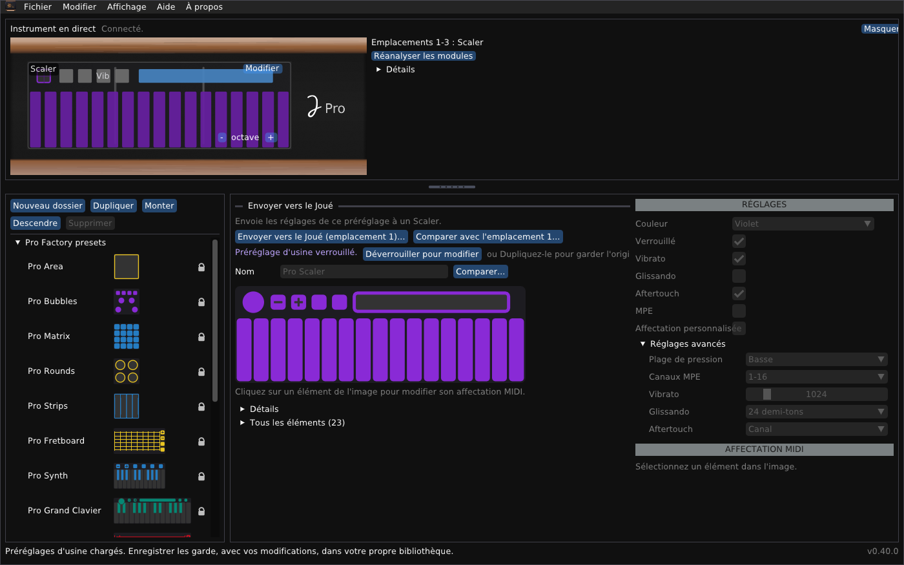

# Joué Revival pour Linux

*[English](README-linux.md) · Français*

Un éditeur indépendant pour l'instrument Joué : les bibliothèques, l'instrument en direct, les réglages de ses modules, et un concepteur de modules.



## En bref

- **Paquet :** `joue-revival-linux-x86_64.AppImage` et `.tar.gz` (l'AppImage a été testé ici ; pas encore de machine Linux avec un instrument), ou compilez depuis les sources (ci-dessous). `joue-editor.sh` compile si nécessaire et lance le programme.
- **Testé :** compile et démarre sous Ubuntu 24.04 (GCC 13, CMake 3.28). La fenêtre et le moteur ont fonctionné avec une carte simulée ; **non testé avec un instrument**.
- **Système de fenêtres :** X11 (il fonctionne sous XWayland, pas dans une session Wayland pure). **MIDI :** ALSA.
- **Préréglages :** les préréglages d'usine sont dans le dossier `presets` et se chargent au premier démarrage.
- **Non affilié :** il n'est ni fabriqué, ni approuvé, ni soutenu par Joué. Utilisez l'éditeur à vos risques. Il ne touche pas au micrologiciel du Joué et ne le fera jamais. Je ne veux pas être responsable de la mise hors service des instruments.
- **Fichiers :** le dossier de données est `$XDG_DATA_HOME/JoueEditorNG`, ou `~/.local/share/JoueEditorNG`.

> [!WARNING]
> **Envoyer des réglages écrit dans la puce d'un module.** La disposition précédente est d'abord sauvegardée dans un fichier et peut être restaurée. Écrire une disposition sur une puce vierge, effacer une puce et la disposition temporaire n'ont été essayés que sur très peu de puces : essayez d'abord avec une seule, les autres modules retirés.

## Installer une version

Téléchargez `joue-revival-linux-x86_64.AppImage`, rendez-le exécutable (`chmod +x joue-revival-linux-x86_64.AppImage`) et lancez-le ; ou décompressez `joue-revival-linux-x86_64.tar.gz` et lancez `joue_editor`. Il faut X11 ou XWayland, OpenGL et ALSA, qu'un poste de bureau a. Ou compilez depuis les sources (ci-dessous).

### Premiers pas

1. **Quittez l'éditeur Joué d'origine.** Il garde les ports MIDI de l'instrument.
2. Branchez le Joué en USB. Le panneau **Instrument en direct**, en haut, indique *Connecté* et montre les modules.
3. Les préréglages d'usine (`presets/factoryLibrary.xml`) se chargent tout seuls la première fois. **Fichier > Ouvrir...** ouvre une autre bibliothèque, et **Enregistrer** garde la vôtre.

## Compiler depuis les sources

Sous Debian ou Ubuntu :

```sh
sudo apt install build-essential cmake git libx11-dev libxrandr-dev libxinerama-dev libxcursor-dev libxi-dev libgl-dev libasound2-dev
cmake -S cpp -B build -DCMAKE_BUILD_TYPE=Release
cmake --build build -j "$(nproc)"
build/joue_editor
```

La première configuration télécharge pugixml, GLFW et Dear ImGui. Sur d'autres distributions installez les paquets de développement équivalents pour X11 (libX11, Xrandr, Xinerama, Xcursor, Xi), OpenGL et ALSA. Sans ALSA le programme se compile mais ne peut pas parler à l'instrument.

Pour parler à l'instrument votre utilisateur doit avoir accès aux ports MIDI ALSA (normalement automatique pour l'utilisateur connecté) ; `aconnect -l` liste les clients MIDI ALSA, le Joué devrait en faire partie.

## Ce que vous pouvez faire

- **Parcourir et modifier des bibliothèques :** préréglages d'usine (verrouillés, non supprimables), vos propres dossiers et copies, enregistrés avec une sauvegarde du fichier précédent.
- **Voir l'instrument en direct :** les modules dans les emplacements, les contacts ; **toucher pour sélectionner** ; **Réanalyser les modules** et un journal de détection si quelque chose semble faux.
- **Modifier un module de l'instrument :** Actions, notes, gammes (23 de l'original et 47 autres), la bulle, le contrôle Y, plage de pression, MPE et aftertouch ; envoyer les modifications ou restaurer l'original.
- **Envoyer un préréglage** à un module du même type, avec la liste de ce qui va changer.
- **L'utiliser en anglais ou en français :** l'interface suit la langue de votre système, et **Affichage > Language / Langue** la change.
- **Concevoir une disposition** (modèles : grille de pads, clavier, grille isomorphe, manche ; aligner, répartir, retourner, répéter), l'imprimer à la taille réelle, l'essayer comme disposition temporaire, l'écrire sur une puce NTAG216 vierge, effacer une puce qui contient une disposition personnalisée : voir le [Guide du concepteur de modules](module-designer.fr.md).

Les fenêtres, les fichiers et le dépannage sont dans le [Guide de l'utilisateur](user-guide.fr.md).

## Limites importantes

- Non testé avec un instrument : le côté MIDI n'a été exercé qu'avec une carte simulée.
- Pas de fenêtre Wayland pure.
- L'écriture sur les puces et la disposition temporaire sont peu testées ailleurs ; le Synth et les modules Play ne sont connus que par les modèles.

## Licence et crédits

Joué Revival est un logiciel libre sous **licence publique générale GNU v3 ou ultérieure** : voir `LICENSE` dans le dépôt. Copyright (C) 2026 Simon Bourdareau. Il est fourni sans aucune garantie. Les préréglages d'usine de `presets/` viennent de l'application du fabricant : ils sont inclus pour que le programme fonctionne tout de suite, et ils ne sont pas couverts par la GPL. Les formats viennent de la rétro-ingénierie des éditeurs du fabricant et du micrologiciel, et du projet officiel [J-Play](https://github.com/Pjoooo/jplay-opensource) (GPL-3.0). Dear ImGui, GLFW, pugixml et stb_image sont utilisés sous leurs propres licences. Programme indépendant : ni fabriqué, ni approuvé, ni soutenu par Joué.
