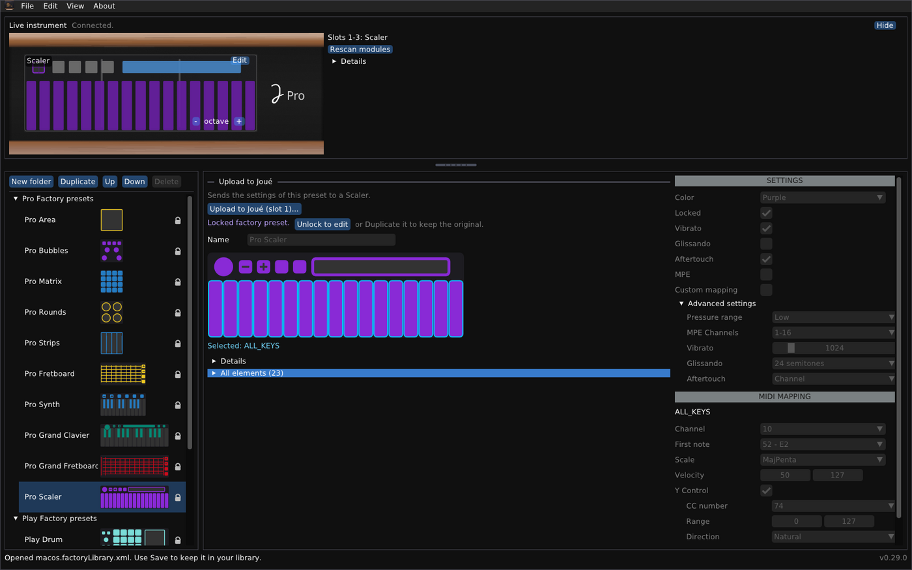

# Joué Revival for Linux

*English · [Français](README-linux.fr.md)*

An independent editor for the Joué instrument: libraries, the instrument live, the settings of its modules, and a module designer.



## At a glance

- **Package:** `joue-revival-linux-x86_64.AppImage` and `.tar.gz` (the AppImage was tested here; no Linux machine with an instrument yet), or build from source (below). `joue-editor.sh` builds when needed and starts the program.
- **Tested:** builds and runs its tests on Ubuntu 24.04 (GCC 13, CMake 3.28). The window and the engine run with a simulated board; **not tested with an instrument**.
- **Window system:** X11 (it works under XWayland, not in a pure Wayland session). **MIDI:** ALSA.
- **Not included:** the manufacturer's factory library; open the one of the original editor.
- **Files:** the data folder is `$XDG_DATA_HOME/JoueEditorNG`, or `~/.local/share/JoueEditorNG`.

> [!WARNING]
> **Uploading writes to the tag of a module.** The previous layout is saved as a file first and can be restored. Writing a layout to a blank tag, erasing a tag and the temporary layout have been tried on very few tags: try one first, with the other modules taken out.

## Install a release

Download `joue-revival-linux-x86_64.AppImage`, make it executable (`chmod +x joue-revival-linux-x86_64.AppImage`) and run it; or unpack `joue-revival-linux-x86_64.tar.gz` and run `joue_editor`. It needs X11 or XWayland, OpenGL and ALSA, which a desktop has. Or build from source (below).

### First steps

1. **Quit the original Joué Editor.** It holds the instrument's MIDI ports.
2. Connect the Joué by USB. The **Live instrument** panel at the top says *Connected* and shows the modules.
3. **File > Open...** and choose the factory library of the original editor (`macos.factoryLibrary.xml` or `editor.factoryLibrary.xml`, from the original application). It is not part of this program.

## Build from source

On Debian or Ubuntu:

```sh
sudo apt install build-essential cmake git libx11-dev libxrandr-dev libxinerama-dev libxcursor-dev libxi-dev libgl-dev libasound2-dev
cmake -S cpp -B build -DCMAKE_BUILD_TYPE=Release
cmake --build build -j "$(nproc)"
build/joue_editor
```

The first configure downloads pugixml, GLFW and Dear ImGui. On other distributions install the equivalent development packages for X11 (libX11, Xrandr, Xinerama, Xcursor, Xi), OpenGL and ALSA. Without ALSA the program builds but cannot talk to the instrument.

To talk to the instrument your user needs access to the ALSA MIDI ports (normally automatic for the logged-in user); `aconnect -l` should list the Joué.

## What you can do

- **Browse and edit libraries:** factory presets (locked, not deletable), your own folders and copies, saved with a backup of the previous file.
- **See the instrument live:** the modules in the slots, the touches; **Rescan modules** and a detection log if something looks wrong.
- **Edit a module in the instrument:** Actions, notes, scales (23 of the original and 47 more), the bubble, the Y control, pressure range, MPE and aftertouch; upload the changes or restore the original.
- **Upload a preset** to a module of the same type, with the list of what will change.
- **Use it in English or French:** the interface follows your system's language, and **View > Language / Langue** changes it.
- **Design a layout** (templates: pad grid, keyboard, isomorphic grid, fretboard; align, distribute, flip, repeat), print it at real size, try it as a temporary layout, write it to a blank NTAG216 tag, erase a tag that holds a custom layout: see the [Module designer guide](module-designer.md).

The windows, the files and the troubleshooting are in the [User guide](user-guide.md).

## Important limitations

- Untested with an instrument: the MIDI side has been exercised on a simulated board only.
- No pure Wayland window.
- Writing to tags and the temporary layout are lightly tested elsewhere; Synth and the Play modules are known from templates only.

## Licence and credits

Joué Revival is free software under the **GNU General Public License v3 or later**: see `LICENSE` in the repository. Copyright (C) 2026 Simon Bourdareau. It comes with no warranty. The manufacturer's factory libraries are not part of it and are not covered by its licence. The formats come from reverse engineering the manufacturer's editors and the firmware, and from the official [J-Play](https://github.com/Pjoooo/jplay-opensource) project (GPL-3.0). Dear ImGui, GLFW, pugixml and stb_image are used under their own licences. Independent program: not made, endorsed or supported by Joué.
