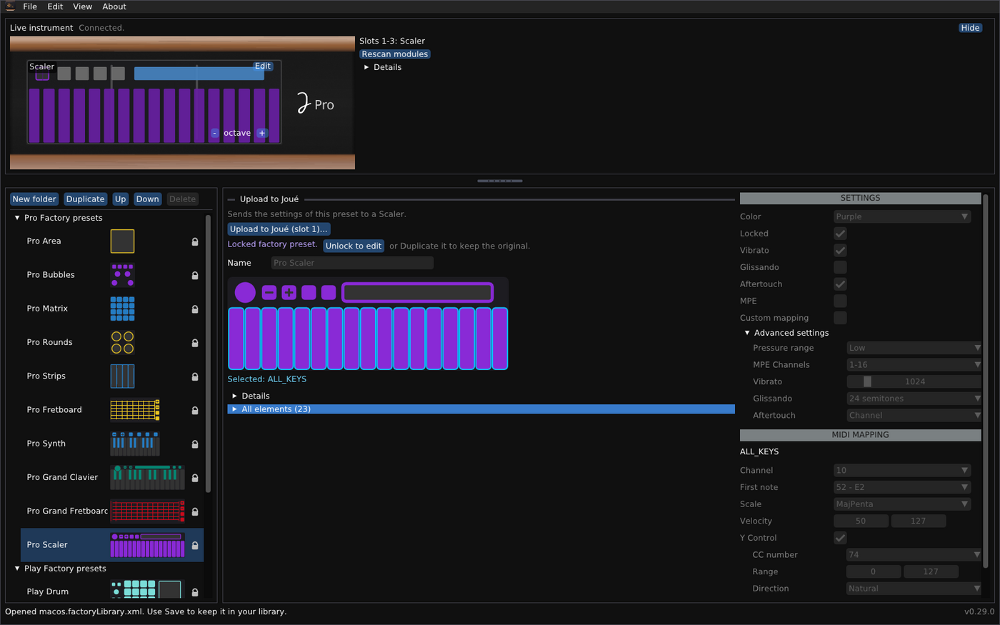

# Joué Revival pour macOS

*[English](README-macos.md) · Français*

Un éditeur indépendant pour l'instrument Joué : les bibliothèques, l'instrument en direct, les réglages de ses modules, et un concepteur de modules.



## En bref

- **Paquet :** `Joue Revival.app` (Apple silicon, arm64), ce README, `user-guide.fr.md`, `module-designer.fr.md` et leurs versions anglaises `README.md`, `user-guide.md`, `module-designer.md` (dans le dépôt ces documents sont dans le dossier `docs`).
- **Testé :** utilisé par son auteur sur un Mac Apple silicon avec un Joué Pro. L'application est signée « ad hoc », **non notariée**.
- **Non inclus :** la bibliothèque d'usine du fabricant ; ouvrez celle qui est dans l'éditeur d'origine (`macos.factoryLibrary.xml`).
- **Fichiers :** le dossier de données est `~/Library/Application Support/JoueEditorNG`.

> [!WARNING]
> **Envoyer des réglages écrit dans la puce d'un module.** La disposition précédente est d'abord sauvegardée dans un fichier et peut être restaurée. Écrire une disposition sur une puce vierge, effacer une puce et la disposition temporaire n'ont été essayés que sur très peu de puces : essayez d'abord avec une seule, les autres modules retirés.

## Installer une version

Ouvrez `joue-revival-macos-arm64.dmg` et glissez l'application dans Applications, ou utilisez le zip :

1. Décompressez le paquet et placez `Joue Revival.app` où vous voulez.
2. Dans le Terminal : `xattr -cr "Joue Revival.app"`. Puis ouvrez l'application. (Sans cela macOS peut dire que l'application est endommagée ; un clic droit dessus puis **Ouvrir** fonctionne aussi.)
3. Sur un Mac Intel, compilez depuis les sources (ci-dessous).

### Premiers pas

1. **Quittez l'éditeur Joué d'origine.** Il garde les ports MIDI de l'instrument.
2. Branchez le Joué en USB. Le panneau **Instrument en direct**, en haut, indique *Connecté* et montre les modules.
3. **Fichier > Ouvrir...** et choisissez la bibliothèque d'usine de l'éditeur d'origine (`macos.factoryLibrary.xml`, dans les ressources de l'application d'origine). Elle ne fait pas partie de ce programme.

Le programme parle à l'instrument par CoreMIDI. Si un autre programme perd les notes, désactivez **Affichage > Écouter le port Play (contacts)**.

## Ce que vous pouvez faire

- **Parcourir et modifier des bibliothèques :** préréglages d'usine (verrouillés, non supprimables), vos propres dossiers et copies, enregistrés avec une sauvegarde du fichier précédent.
- **Voir l'instrument en direct :** les modules dans les emplacements, les contacts ; **toucher pour sélectionner** ; **Réanalyser les modules** et un journal de détection si quelque chose semble faux.
- **Modifier un module de l'instrument :** Actions, notes, gammes (23 de l'original et 47 autres), la bulle, le contrôle Y, plage de pression, MPE et aftertouch ; envoyer les modifications ou restaurer l'original.
- **Envoyer un préréglage** à un module du même type, avec la liste de ce qui va changer.
- **L'utiliser en anglais ou en français :** l'interface suit la langue de votre système, et **Affichage > Language / Langue** la change.
- **Concevoir une disposition** (modèles : grille de pads, clavier, grille isomorphe, manche ; aligner, répartir, retourner, répéter), l'imprimer à la taille réelle, l'essayer comme disposition temporaire, l'écrire sur une puce NTAG216 vierge, effacer une puce qui contient une disposition personnalisée : voir le [Guide du concepteur de modules](module-designer.fr.md).

Les fenêtres, les fichiers et le dépannage sont dans le [Guide de l'utilisateur](user-guide.fr.md).

## Compiler depuis les sources

Installez les outils en ligne de commande de Xcode (`xcode-select --install`) et CMake (`brew install cmake`). La première configuration télécharge pugixml, GLFW et Dear ImGui.

```sh
cmake -S cpp -B build -DCMAKE_BUILD_TYPE=Release
cmake --build build -j 4
build/joue_editor
```

Un double-clic sur `Joue Editor.command` compile à la première utilisation et lance le programme.

Pour fabriquer une application, `packaging/package-release.sh macos build dist` (depuis le dépôt, après la compilation) crée `Joue Revival.app` avec son `Info.plist` et la signe « ad hoc » avec `codesign`.

## Limites importantes

- Seul Apple silicon est publié et testé ; une compilation Intel devrait fonctionner et n'a pas été lancée.
- L'application n'est pas notariée.
- L'écriture sur les puces et la disposition temporaire sont peu testées ; le Synth et les modules Play ne sont connus que par les modèles.

## Licence et crédits

Joué Revival est un logiciel libre sous **licence publique générale GNU v3 ou ultérieure** : voir `LICENSE` dans le dépôt. Copyright (C) 2026 Simon Bourdareau. Il est fourni sans aucune garantie. Les bibliothèques d'usine du fabricant n'en font pas partie et ne sont pas couvertes par sa licence. Les formats viennent de la rétro-ingénierie des éditeurs du fabricant et du micrologiciel, et du projet officiel [J-Play](https://github.com/Pjoooo/jplay-opensource) (GPL-3.0). Dear ImGui, GLFW, pugixml et stb_image sont utilisés sous leurs propres licences. Programme indépendant : ni fabriqué, ni approuvé, ni soutenu par Joué.
