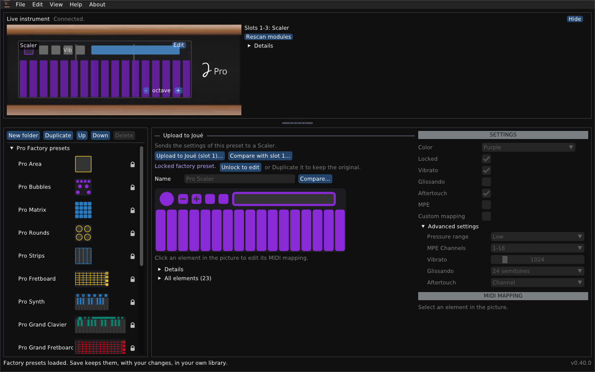

# Joué Revival for macOS

*English · [Français](README-macos.fr.md)*

An independent editor for the Joué instrument: libraries, the instrument live, the settings of its modules, and a module designer.



## At a glance

- **Package:** `Joue Revival.app` (Apple silicon, arm64), this README, `user-guide.md`, `module-designer.md` and their French versions `README.fr.md`, `user-guide.fr.md`, `module-designer.fr.md` (in the repository these documents are in the `docs` folder).
- **Tested:** used by its author on an Apple-silicon Mac with a Joué Pro. The app is signed ad hoc, **not notarized**.
- **Presets:** the factory presets are in the `presets` folder and load at the first start.
- **Not affiliated:** It is not made, endorsed or supported by Joué. Use the editor at your own risk. It does not touch Joué firmware and never will. I do not want to be responsible for bricking the instruments.
- **Files:** the data folder is `~/Library/Application Support/JoueEditorNG`.

> [!WARNING]
> **Uploading writes to the tag of a module.** The previous layout is saved as a file first and can be restored. Writing a layout to a blank tag, erasing a tag and the temporary layout have been tried on very few tags: try one first, with the other modules taken out.

## Install a release

Open `joue-revival-macos-arm64.dmg` and drag the app to Applications, or use the zip:

1. Unzip the package and move `Joue Revival.app` where you like.
2. In Terminal: `xattr -cr "Joue Revival.app"`. Then open the app. (Without this macOS may say the app is damaged; a right click on it and **Open** also works.)
3. On an Intel Mac, build from source (below).

### First steps

1. **Quit the original Joué Editor.** It holds the instrument's MIDI ports.
2. Connect the Joué by USB. The **Live instrument** panel at the top says *Connected* and shows the modules.
3. The factory presets (`presets/factoryLibrary.xml`) load by themselves the first time. **File > Open...** opens another library, and **Save** keeps your own.

The program talks to the instrument through CoreMIDI. If another program loses the notes, switch off **View > Listen to the Play port (touches)**.

## What you can do

- **Browse and edit libraries:** factory presets (locked, not deletable), your own folders and copies, saved with a backup of the previous file.
- **See the instrument live:** the modules in the slots, the touches; **Rescan modules** and a detection log if something looks wrong.
- **Edit a module in the instrument:** Actions, notes, scales (23 of the original and 47 more), the bubble, the Y control, pressure range, MPE and aftertouch; upload the changes or restore the original.
- **Upload a preset** to a module of the same type, with the list of what will change.
- **Use it in English or French:** the interface follows your system's language, and **View > Language / Langue** changes it.
- **Design a layout** (templates: pad grid, keyboard, isomorphic grid, fretboard; align, distribute, flip, repeat), print it at real size, try it as a temporary layout, write it to a blank NTAG216 tag, erase a tag that holds a custom layout: see the [Module designer guide](module-designer.md).

The windows, the files and the troubleshooting are in the [User guide](user-guide.md).

## Build from source

Install the Xcode command line tools (`xcode-select --install`) and CMake (`brew install cmake`). The first configure downloads pugixml, GLFW and Dear ImGui.

```sh
cmake -S cpp -B build -DCMAKE_BUILD_TYPE=Release
cmake --build build -j 4
build/joue_editor
```

Double-clicking `Joue Editor.command` builds on first use and starts the program.

To make an app bundle, `packaging/package-release.sh macos build dist` (from the repository, after the build) makes `Joue Revival.app` with its `Info.plist` and signs it ad hoc with `codesign`.

## Important limitations

- Only Apple silicon is released and tested; an Intel build is expected to work and has not been run.
- The app is not notarized.
- Writing to tags and the temporary layout are lightly tested; Synth and the Play modules are known from templates only.

## Licence and credits

Joué Revival is free software under the **GNU General Public License v3 or later**: see `LICENSE` in the repository. Copyright (C) 2026 Simon Bourdareau. It comes with no warranty. The factory presets in `presets/` come from the manufacturer's application: they are included so that the program works at once, and they are not covered by the GPL. The formats come from reverse engineering the manufacturer's editors and the firmware, and from the official [J-Play](https://github.com/Pjoooo/jplay-opensource) project (GPL-3.0). Dear ImGui, GLFW, pugixml and stb_image are used under their own licences. Independent program: not made, endorsed or supported by Joué.
