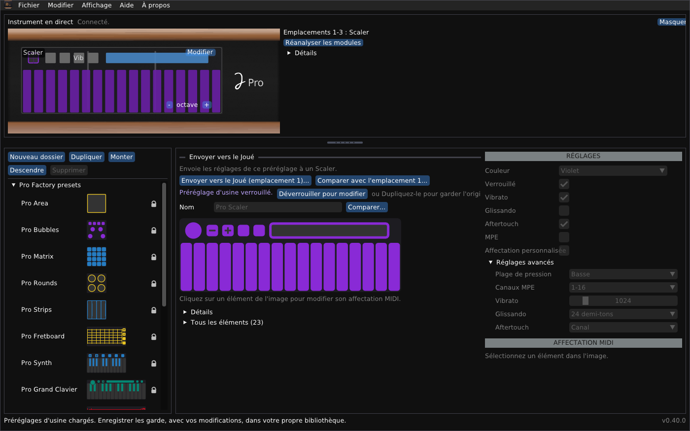

# Joué Revival pour Windows

*[English](README-windows.md) · Français*

Un éditeur indépendant pour l'instrument Joué : les bibliothèques, l'instrument en direct, les réglages de ses modules, et un concepteur de modules.



## En bref

- **Paquet :** `JoueRevival.exe` (64 bits, sans DLL supplémentaire ; il existe aussi un programme d'installation), `JoueRevival-safe-graphics.bat`, ce README, `user-guide.fr.md`, `module-designer.fr.md` et leurs versions anglaises `README.md`, `user-guide.md`, `module-designer.md` (dans le dépôt ces documents sont dans le dossier `docs`).
- **Testé :** utilisé par son auteur sous Windows 11 avec un Joué Pro. L'exécutable est compilé en croisé avec MinGW-w64 et fonctionne aussi sous Wine.
- **Préréglages :** les préréglages d'usine sont dans le dossier `presets` et se chargent au premier démarrage.
- **Non affilié :** il n'est ni fabriqué, ni approuvé, ni soutenu par Joué. Utilisez l'éditeur à vos risques. Il ne touche pas au micrologiciel du Joué et ne le fera jamais. Je ne veux pas être responsable de la mise hors service des instruments.
- **Fichiers :** le dossier de données est `%APPDATA%\JoueEditorNG`.

> [!WARNING]
> **Envoyer des réglages écrit dans la puce d'un module.** La disposition précédente est d'abord sauvegardée dans un fichier et peut être restaurée. Écrire une disposition sur une puce vierge, effacer une puce et la disposition temporaire n'ont été essayés que sur très peu de puces : essayez d'abord avec une seule, les autres modules retirés.

## Installer une version

Lancez `joue-revival-windows-x64-setup.exe` pour l'installer (une entrée dans le menu Démarrer, une icône de bureau facultative et un désinstallateur), ou utilisez le zip :

1. Décompressez tout le paquet dans un dossier.
2. Lancez `JoueRevival.exe`. SmartScreen peut signaler un éditeur inconnu (le fichier n'est pas signé) : **Informations complémentaires**, puis **Exécuter quand même**.
3. Si certaines zones sont dessinées en noir, lancez `JoueRevival-safe-graphics.bat`. `JoueRevival.exe --scale 1.5` agrandit tout.

Pour supprimer le programme, supprimez le dossier, et `%APPDATA%\JoueEditorNG` si vous voulez oublier votre bibliothèque.

### Premiers pas

1. **Quittez l'éditeur Joué d'origine.** Il garde les ports MIDI de l'instrument.
2. Branchez le Joué en USB. Le panneau **Instrument en direct**, en haut, indique *Connecté* et montre les modules.
3. Les préréglages d'usine (`presets/factoryLibrary.xml`) se chargent tout seuls la première fois. **Fichier > Ouvrir...** ouvre une autre bibliothèque, et **Enregistrer** garde la vôtre.

Sous Windows 11 plusieurs programmes peuvent écouter les ports MIDI de l'instrument en même temps. Sur les systèmes plus anciens le premier programme qui ouvre un port le garde ; si un autre programme perd les notes, désactivez **Affichage > Écouter le port Play (contacts)**.

## Ce que vous pouvez faire

- **Parcourir et modifier des bibliothèques :** préréglages d'usine (verrouillés, non supprimables), vos propres dossiers et copies, enregistrés avec une sauvegarde du fichier précédent.
- **Voir l'instrument en direct :** les modules dans les emplacements, les contacts ; **toucher pour sélectionner** ; **Réanalyser les modules** et un journal de détection si quelque chose semble faux.
- **Modifier un module de l'instrument :** Actions, notes, gammes (23 de l'original et 47 autres), la bulle, le contrôle Y, plage de pression, MPE et aftertouch ; envoyer les modifications ou restaurer l'original.
- **Envoyer un préréglage** à un module du même type, avec la liste de ce qui va changer.
- **L'utiliser en anglais ou en français :** l'interface suit la langue de votre système, et **Affichage > Language / Langue** la change.
- **Concevoir une disposition** (modèles : grille de pads, clavier, grille isomorphe, manche ; aligner, répartir, retourner, répéter), l'imprimer à la taille réelle, l'essayer comme disposition temporaire, l'écrire sur une puce NTAG216 vierge, effacer une puce qui contient une disposition personnalisée : voir le [Guide du concepteur de modules](module-designer.fr.md).

Les fenêtres, les fichiers et le dépannage sont dans le [Guide de l'utilisateur](user-guide.fr.md).

## Compiler depuis les sources

Il faut CMake 3.20 ou plus récent, un compilateur C++17 et git ; la première configuration télécharge pugixml, GLFW et Dear ImGui.

Le programme Windows a jusqu'ici été compilé avec MinGW-w64, en compilation croisée sous Linux. Le workflow de publication le compile avec MSYS2 sur une machine Windows, avec ces étapes ; cela n'a pas encore tourné, et compiler à la main sous Windows n'a pas été testé.

**MSYS2** (ouvrez *MSYS2 MinGW 64-bit*) :

```sh
pacman -S --needed mingw-w64-x86_64-toolchain mingw-w64-x86_64-cmake mingw-w64-x86_64-ninja git
cmake -S cpp -B build -G Ninja
cmake --build build
build/joue_editor.exe
```

**Visual Studio 2022** (charge de travail C++ et outils CMake) :

```bat
cmake -S cpp -B build -G "Visual Studio 17 2022" -A x64
cmake --build build --config Release
build\Release\joue_editor.exe
```

`Joue Editor.bat` dans le dépôt compile à la première utilisation et lance le programme.

## Limites importantes

- L'écriture sur les puces et la disposition temporaire sont peu testées ; le Synth et les modules Play ne sont connus que par les modèles.
- Une lecture d'un emplacement peut renvoyer le module d'un autre : le programme vérifie le type ; **Réanalyser les modules** et le journal de détection aident.
- Compiler sous Windows même n'est pas testé.

## Licence et crédits

Joué Revival est un logiciel libre sous **licence publique générale GNU v3 ou ultérieure** : voir `LICENSE` dans le dépôt. Copyright (C) 2026 Simon Bourdareau. Il est fourni sans aucune garantie. Les préréglages d'usine de `presets/` viennent de l'application du fabricant : ils sont inclus pour que le programme fonctionne tout de suite, et ils ne sont pas couverts par la GPL. Les formats viennent de la rétro-ingénierie des éditeurs du fabricant et du micrologiciel, et du projet officiel [J-Play](https://github.com/Pjoooo/jplay-opensource) (GPL-3.0). Dear ImGui, GLFW, pugixml et stb_image sont utilisés sous leurs propres licences. Programme indépendant : ni fabriqué, ni approuvé, ni soutenu par Joué.
