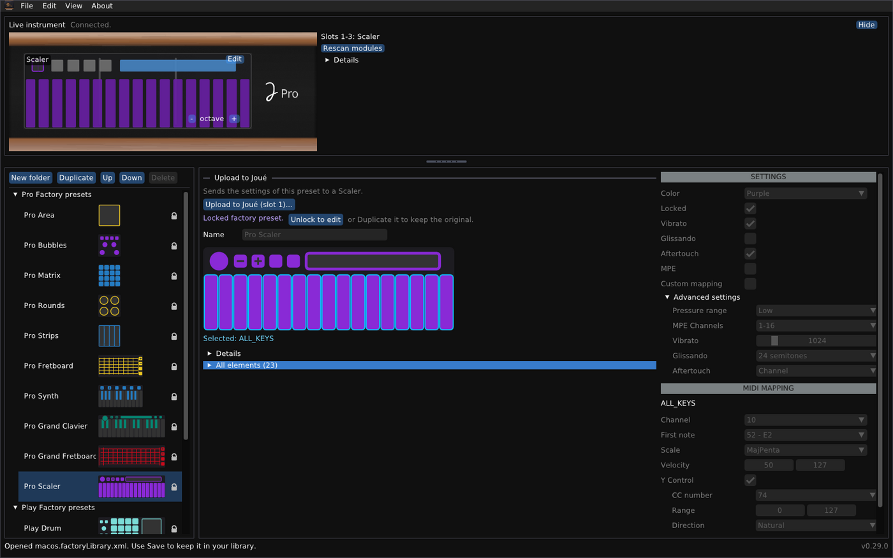

# Joué Revival for Windows

*English · [Français](README-windows.fr.md)*

An independent editor for the Joué instrument: libraries, the instrument live, the settings of its modules, and a module designer.



## At a glance

- **Package:** `JoueRevival.exe` (64-bit, no installer, no extra DLLs), `JoueRevival-safe-graphics.bat`, this README, `user-guide.md`, `module-designer.md` and their French versions `README.fr.md`, `user-guide.fr.md`, `module-designer.fr.md` (in the repository these documents are in the `docs` folder).
- **Tested:** used by its author on Windows 11 with a Joué Pro. The executable is cross-compiled with MinGW-w64 and also runs under Wine.
- **Not included:** the manufacturer's factory library; open the one of the original editor (`editor.factoryLibrary.xml`).
- **Files:** the data folder is `%APPDATA%\JoueEditorNG`.

> [!WARNING]
> **Uploading writes to the tag of a module.** The previous layout is saved as a file first and can be restored. Writing a layout to a blank tag, erasing a tag and the temporary layout have been tried on very few tags: try one first, with the other modules taken out.

## Install a release

Run `joue-revival-windows-x64-setup.exe` to install it (a Start menu entry, an optional desktop icon, and an uninstaller), or use the zip:

1. Unzip the whole package into a folder.
2. Run `JoueRevival.exe`. SmartScreen may warn about an unknown publisher (the file is not signed): **More info**, then **Run anyway**.
3. If some areas are drawn black, run `JoueRevival-safe-graphics.bat`. `JoueRevival.exe --scale 1.5` makes everything larger.

To remove the program, delete the folder, and `%APPDATA%\JoueEditorNG` if you want to forget your library.

### First steps

1. **Quit the original Joué Editor.** It holds the instrument's MIDI ports.
2. Connect the Joué by USB. The **Live instrument** panel at the top says *Connected* and shows the modules.
3. **File > Open...** and choose the factory library of the original editor (`editor.factoryLibrary.xml`). It is not part of this program.

On Windows 11 several programs can listen to the instrument's MIDI ports at once. On older systems the first program to open a port keeps it; if another program loses the notes, switch off **View > Listen to the Play port (touches)**.

## What you can do

- **Browse and edit libraries:** factory presets (locked, not deletable), your own folders and copies, saved with a backup of the previous file.
- **See the instrument live:** the modules in the slots, the touches; **Rescan modules** and a detection log if something looks wrong.
- **Edit a module in the instrument:** Actions, notes, scales (23 of the original and 47 more), the bubble, the Y control, pressure range, MPE and aftertouch; upload the changes or restore the original.
- **Upload a preset** to a module of the same type, with the list of what will change.
- **Use it in English or French:** the interface follows your system's language, and **View > Language / Langue** changes it.
- **Design a layout** (templates: pad grid, keyboard, isomorphic grid, fretboard; align, distribute, flip, repeat), print it at real size, try it as a temporary layout, write it to a blank NTAG216 tag, erase a tag that holds a custom layout: see the [Module designer guide](module-designer.md).

The windows, the files and the troubleshooting are in the [User guide](user-guide.md).

## Build from source

Needs CMake 3.20 or newer, a C++17 compiler and git; the first configure downloads pugixml, GLFW and Dear ImGui.

The Windows program has so far been built with MinGW-w64, cross-compiled on Linux. The release workflow builds it with MSYS2 on a Windows machine, with these steps; that has not run yet, and building by hand on Windows has not been tested.

**MSYS2** (open *MSYS2 MinGW 64-bit*):

```sh
pacman -S --needed mingw-w64-x86_64-toolchain mingw-w64-x86_64-cmake mingw-w64-x86_64-ninja git
cmake -S cpp -B build -G Ninja
cmake --build build
build/joue_editor.exe
```

**Visual Studio 2022** (C++ workload and CMake tools):

```bat
cmake -S cpp -B build -G "Visual Studio 17 2022" -A x64
cmake --build build --config Release
build\Release\joue_editor.exe
```

`Joue Editor.bat` in the repository builds on first use and starts the program.

## Important limitations

- Writing to tags and the temporary layout are lightly tested; Synth and the Play modules are known from templates only.
- A read of a slot can return another slot's module: the program checks the type; **Rescan modules** and the detection log help.
- Building on Windows itself is untested.

## Licence and credits

Joué Revival is free software under the **GNU General Public License v3 or later**: see `LICENSE` in the repository. Copyright (C) 2026 Simon Bourdareau. It comes with no warranty. The manufacturer's factory libraries are not part of it and are not covered by its licence. The formats come from reverse engineering the manufacturer's editors and the firmware, and from the official [J-Play](https://github.com/Pjoooo/jplay-opensource) project (GPL-3.0). Dear ImGui, GLFW, pugixml and stb_image are used under their own licences. Independent program: not made, endorsed or supported by Joué.
