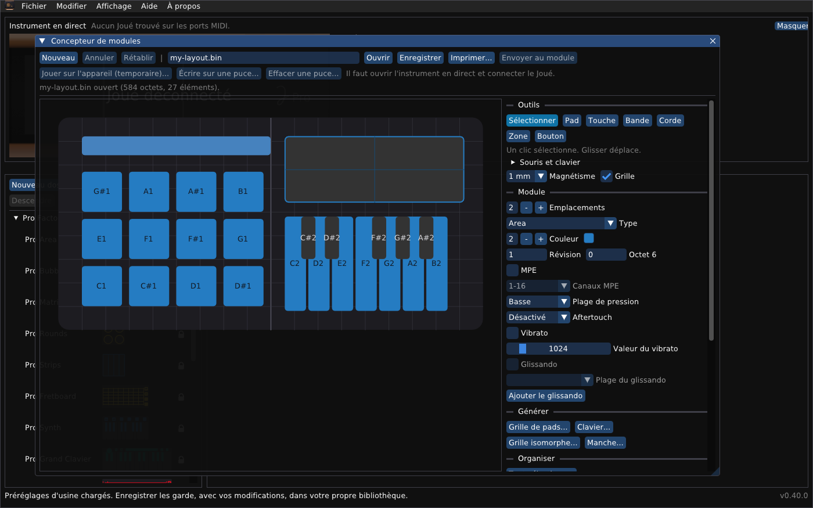

# Joué Revival : guide du concepteur de modules

*[English](module-designer.md) · Français*

Le concepteur de modules dessine la disposition d'un module : où sont ses pads, touches, bandes, cordes et zones, et ce que chacun envoie. Une disposition est un petit fichier binaire (un *blob de module*, de 888 octets au plus) du genre de celui qui se trouve sur la puce d'un module. Ce guide couvre son dessin, et ce que vous pouvez en faire : l'imprimer à la taille réelle, l'essayer sur l'instrument sans aucune puce, l'écrire sur une puce vierge, effacer une puce.

Ouvrez-le avec **Fichier > Concepteur de modules...** (ou **Affichage > Concepteur de modules**), ou lancez le programme avec `--designer FICHIER`.

> [!WARNING]
> **Écrire une disposition sur une puce et effacer une puce sont peu testés.** Essayez d'abord avec une seule puce, les autres modules retirés de l'instrument. Une disposition du fabricant n'est jamais effacée par le programme.

## Sommaire

1. [La fenêtre](#la-fenêtre)
2. [La surface](#la-surface)
3. [Sélectionner et déplacer](#sélectionner-et-déplacer)
4. [L'inspecteur](#linspecteur)
5. [Générer des dispositions : grilles de pads, claviers, grilles isomorphes, manches](#générer-des-dispositions)
6. [Organiser : aligner, répartir, retourner, répéter](#organiser--aligner-répartir-retourner-répéter)
7. [Vérifier une disposition](#vérifier-une-disposition)
8. [Enregistrer et ouvrir](#enregistrer-et-ouvrir)
9. [Imprimer à la taille réelle](#imprimer-à-la-taille-réelle)
10. [Une disposition temporaire, sans puce](#une-disposition-temporaire-sans-puce)
11. [Écrire une disposition sur une puce vierge](#écrire-une-disposition-sur-une-puce-vierge)
12. [Effacer une puce](#effacer-une-puce)
13. [Ce qui arrive à chaque sorte de puce](#ce-qui-arrive-à-chaque-sorte-de-puce)
14. [Limites](#limites)

## La fenêtre

La barre d'outils a deux rangées.

| Bouton | Ce qu'il fait |
|---|---|
| **Nouveau** | Une disposition vide ; un petit menu demande 1 emplacement (90 mm), 2 emplacements (180 mm) ou 3 emplacements (270 mm). |
| **Annuler**, **Rétablir** | Chaque modification ; aussi Ctrl+Z et Maj+Ctrl+Z sur la surface. |
| champ du chemin, **Ouvrir**, **Enregistrer** | Où la disposition est gardée, et les deux boutons qui lisent et écrivent ce fichier. |
| **Imprimer...** | Un PDF à la taille réelle. |
| **Envoyer au module** | Indisponible : une disposition se met sur l'instrument avec les trois boutons suivants. |
| **Jouer sur l'appareil (temporaire)...** | Essaie la disposition sur l'instrument tout de suite, sans puce. |
| **Écrire sur une puce...** | L'écrit sur une puce NTAG216 vierge. |
| **Effacer une puce...** | Vide une puce qui contient une disposition personnalisée. |

Les trois derniers demandent que le panneau **Instrument en direct** soit ouvert et le Joué connecté ; sinon ils sont grisés.

## La surface

La grande image est le module, vu comme dans la fenêtre principale (en miroir). Un emplacement fait 90 mm de large et 90 mm de haut ; un module a un, deux ou trois emplacements. Les millimètres sont l'unité partout : positions, tailles, magnétisme.

- **Magnétisme** (1, 2, 5 ou 10 mm) arrondit ce que vous dessinez et déplacez. **Grille** montre un trait tous les 10 mm et un plus marqué au bord de chaque emplacement.
- Les éléments qui se chevauchent sont permis (les touches noires d'un clavier sont posées sur les blanches). Un élément sur un **Calque** plus haut est dessiné dessus et est sélectionné en premier ; la **Vérification** signale un chevauchement sur le même calque, où un toucher peut être ambigu.

## La fenêtre du concepteur

Le concepteur est une fenêtre à part. Faites glisser sa barre de titre : elle peut sortir de la fenêtre principale, vers un autre écran si vous en avez un ; déposée sur la fenêtre principale, elle y rentre de nouveau. `--single-window` garde toutes les fenêtres à l'intérieur de la fenêtre principale.

## Sélectionner et déplacer

La barre d'outils de l'inspecteur a **Sélectionner**, **Pad**, **Touche**, **Bande**, **Corde**, **Zone**, **Bouton**. Avec **Sélectionner**, les gestes sont :

| Geste | Effet |
|---|---|
| Clic | Sélectionne un élément ; un clic sur un endroit vide ne sélectionne rien. |
| Glisser sur un endroit vide | Trace un rectangle de sélection : chaque élément qu'il couvre est sélectionné. |
| Ctrl + clic (Cmd sur Mac) | Ajoute un élément à la sélection, ou le retire. |
| Ctrl + glisser | Déplace tout ce qui est sélectionné, en gardant leur écartement ; le groupe s'arrête au bord de la surface d'un seul bloc. Sur un élément pas encore sélectionné, il est d'abord sélectionné. Sur un endroit vide, le rectangle s'ajoute à la sélection au lieu de la remplacer. |
| Glisser | Déplace un élément. |
| Maj + glisser | Redimensionne, dans toutes les directions. L'endroit où vous appuyez décide de ce qui bouge : près d'un côté, ce côté ; près d'un coin, les deux côtés ; au milieu, l'élément se déplace à la place. Avec plusieurs éléments sélectionnés, l'appui compte sur la boîte qui les entoure tous, et chaque élément est mis à l'échelle avec cette boîte. |
| Maj + glisser depuis le milieu sur un autre élément, relâcher | Les deux échangent leurs places, chacun gardant sa taille et ses réglages. Seulement après au moins 8 mm de déplacement ; l'autre est entouré en vert ; refusé si l'un sortait de la surface. |
| Alt + glisser | Dessine un nouvel élément du dernier outil utilisé (un pad au début), de l'endroit où vous appuyez à celui où vous relâchez. |
| Poignées de coin | Étirent l'élément que montre l'inspecteur. |

Un côté est le tiers extérieur de l'élément (ou de la boîte autour du groupe) ; le curseur montre ce que ferait un appui. Tout ce qui est sélectionné est entouré de cyan et éclairci ; avec plusieurs éléments sélectionnés, une boîte avec de petits carrés montre le groupe entier.

Avec un outil autre que Sélectionner, un glissement sur la surface dessine cette sorte d'élément ; un clic lui donne une taille par défaut.

Touches, quand le pointeur est sur la surface :

| Touche | Effet |
|---|---|
| Suppr ou Retour arrière | Supprime tout ce qui est sélectionné. |
| Ctrl+D | Duplique tout ce qui est sélectionné. |
| Ctrl+C, Ctrl+V | Copier et coller ; chaque collage va 4 mm plus loin. Les éléments peuvent être collés dans une autre disposition. |
| Flèches | Déplacent tout ce qui est sélectionné de 1 mm (Maj : 10 mm). |
| Ctrl+A, ou le bouton **Tout sélectionner** | Sélectionne tous les éléments. |
| Échap | Ne sélectionne rien et revient à Sélectionner. |

## L'inspecteur

À droite, de haut en bas :

- **Outils**, **Magnétisme**, **Grille**, et un rappel des gestes (**Souris et clavier**).
- **Module :** **Emplacements** (1 à 3), **Type** (le genre de module pour lequel est cette disposition ; les autres éditeurs reconnaissent une disposition à son type, donc un type du fabricant leur fait la prendre pour ce module, une Pro Area par exemple ; **Personnalisé (200)** est un type qu'aucun module n'a, montré comme un module inconnu par les autres éditeurs et traité comme le vôtre par ce programme ; il n'a pas été essayé sur l'instrument, donc si la carte ne l'accepte pas, prenez un type de la liste), **Couleur**, **Révision**, **Position de la puce** (où se trouve la puce dans le module, en comptant à partir de 1 à gauche, 0 comptant pour 1 : la carte dit l'emplacement où elle lit la puce, et le module commence à cet emplacement moins ce nombre plus un ; les modules Pro ont 1, les modules Play 3 ; pour un module de deux ou trois emplacements, réglez-la là où vous mettez la puce, et **Écrire sur une puce...** dit sur quels emplacements le module sera et refuse un emplacement où il ne tiendrait pas), **MPE**, **Canaux MPE**, **Plage de pression**, **Aftertouch** (voir plus bas).
- **Générer :** grilles de pads, claviers, grilles isomorphes et manches (ci-dessous).
- **Organiser :** aligner, répartir, retourner et répéter ce qui est sélectionné (ci-dessous).
- **Élément sélectionné :** sa place et sa taille (**X**, **Y**, **Largeur**, **Hauteur** en mm), **Calque**, **Z**, **Plage de pression**, pour une touche **Contrôle Y** (voir plus bas), **Profondeur** (l'octet de pression brut : 40 pour un pad en Basse), **Options** (un octet hexadécimal), puis les champs de son genre : pour un pad ou une touche la **Note**, le **Canal**, la plage de **Vélocité** et le reste ; pour une bande, une corde ou une zone les contrôles qu'elle envoie. Avec plusieurs éléments sélectionnés, l'inspecteur montre le dernier sélectionné et dit combien il y en a.
- **Script :** le **Script de démarrage**, un texte que l'instrument exécute quand le module démarre. Les vrais modules l'utilisent pour le vibrato, l'aftertouch et le glissando (`l3.5=2`, par exemple). Laissez-le désactivé sauf si vous connaissez les commandes ; voir *Le script de démarrage* plus bas.
- **Vérification :** voir plus bas.

### Paramètres, comme dans les modules du fabricant

Les paramètres ont les noms, les choix et les valeurs que l'éditeur principal montre pour les modules du fabricant, et ils sont écrits là où les modules du fabricant les gardent. Ouvrir un vrai module dans le concepteur montre ses propres valeurs (le Scaler : MPE activé, 1-16, Haute, Canal ; ses touches : Contrôle Y activé, CC 74, plage de 0 à 127, Naturel, Absolu).

| Paramètre | Où | Choix |
|---|---|---|
| **MPE** | l'octet d'options de l'en-tête du module, bit 0 | activé, désactivé |
| **Canaux MPE** | le même octet, bits 4 et 5 | 1-16, 1-8, 9-16 |
| **Plage de pression** (module) | l'octet de profondeur de chaque pad, touche, corde et zone | Basse, Haute ; *Personnalisé* quand ils diffèrent |
| **Plage de pression** (élément) | son octet de profondeur | Basse, Haute, Personnalisé ; Basse et Haute dépendent du genre : pad 40 et 70, touche 40 et 60, corde 30 et 50, zone 40 et 70, et 80 et 107 pour la bulle du Scaler et du Grand Clavier |
| **Aftertouch** | le script de démarrage : `*.23=1;` (Canal) ou `*.22=1;` (Polyphonique) | Désactivé, Canal, Polyphonique |
| **Contrôle Y** (touches, version 2) | les options de la touche (bit 5 activé, bit 3 relatif), son numéro de CC, sa plage | activé ou non ; **Numéro de CC** de 0 à 127 ; **Plage** ; **Direction** Naturel ou Inversé (les deux bouts de la plage échangés) ; **Mode** Absolu ou Relatif |
| **Vibrato** et **Valeur du vibrato** | le script de démarrage : `<cible>.2=1;` l'active, `<cible>.5=<valeur>;` est sa valeur | activé ou non ; la valeur de 0 à 8192. La cible est celle de l'autre commande de vibrato, ou `*` |
| **Glissando** et **Plage du glissando** | les options des touches (bit 7, `0x80`) et `c14.4=1;` (ou `c14.4=0;`) dans le script ; la plage est la plage de hauteur d'un élément **Glide** | activé ou non ; 2, 3, 4, 5, 7, 12, 24, 48 ou 96 demi-tons. **Ajouter le glissando** crée le Glide pour chaque pad et touche ; **Mettre à jour les touches du glissando** prend en compte celles ajoutées depuis ; **Supprimer le glissando** retire tout |
| **Action d'un bouton** (l'outil **Bouton**) | le texte de commande du bouton | **Vibrato activé/désactivé**, **Choix du canal**, **Sustain activé/désactivé**, **Bending activé/désactivé**, **Contrôle Y activé/désactivé**, **Aftertouch activé/désactivé** (canal ou polyphonique), **Glissando activé/désactivé**, **Fretless activé/désactivé**, **Octave vers le bas**, **Octave vers le haut**, ou une **Commande personnalisée** |
| **Canal**, **Note**, **Vélocité** | les champs de l'élément | comme dans l'éditeur principal |

Un **bouton** a une **Action**, une **Cible** et, pour *Choix du canal*, un **Canal**. La commande qu'il écrit est celle que contiennent les boutons du fabricant : par exemple *Vibrato activé/désactivé* avec la cible `l3` donne `l3.2^1;`. La **Cible** dit sur quoi l'action agit : `*` tous les éléments, `l3` les éléments du calque 3, `l{2,3}` les calques 2 et 3, `c6` les cordes, `c2` les pads, `c5` les touches. Un bouton est dessiné avec un court symbole (Vib, Sus, Bend, Y, AT, Gliss, Fret, -12, +12, Ch n). Un bouton d'action suit la **Plage de pression** du module (profondeur 40 ou 70) ; un bouton d'octave n'est pas sensible à la pression (profondeur 127), comme dans les vrais modules. L'action *Glissando* fonctionne avec l'élément Glide du réglage **Glissando** du module. Le Glide ne peut pas être cliqué sur la surface (il cacherait les touches qu'il couvre) : il se gère avec ce réglage. Le vibrato et le glissando ont été mesurés sur les quatre vrais modules : tous quatre ont le vibrato désactivé et une valeur (1024, 1024, 2 ; aucune sur le Grand Fretboard), et le Scaler et le Grand Clavier ont le glissando activé à 48 demi-tons. Dans l'éditeur d'origine, activer le glissando du Scaler désactive aussi son vibrato ; le concepteur laisse les deux comme vous les réglez. Les pads qui envoient un changement de contrôle, un changement de programme ou un pitch bend au lieu d'une note ne sont pas encore dans le concepteur ; le script de démarrage peut les faire à la main (voir *Le script de démarrage* plus bas). Changer l'**Aftertouch** garde la cible de la commande quand le script en a déjà une (`l{2,3}.22=1;` reste sur les calques 2 et 3) et sinon utilise `*`, c'est-à-dire tous les éléments. Tout cela a été vérifié sur les quatre vrais modules, pas sur un instrument.

### Le script de démarrage

Le script est une liste de commandes, chacune finissant par `;`. Une commande est une *cible*, un point, un numéro, un opérateur et une valeur, par exemple `l3.5=1024;`. La cible est `*` (tous les éléments), `l3` ou `l{2,3}` (les éléments de ces calques) ou `c6` (un genre d'élément : `c2` pads, `c3` bandes, `c5` touches, `c6` cordes, `c7` zones, `c14` le Glide). L'opérateur `=` met le numéro à la valeur, `^` inverse les bits de la valeur, `+` et `-` ajoutent et retranchent. Les numéros utilisés par les modules et les boutons du fabricant sont : **1** canal, **2** vibrato, **3** bending (cordes), **4** décalage d'octave en notes, **5** valeur du vibrato, **6** valeur du bending (cordes), **11** plage de hauteur (cordes), **20** options des éléments (`^32` contrôle Y, `^128` glissando), **21** sustain, **22** aftertouch polyphonique, **23** aftertouch de canal, **24** fretless (cordes), et, sur le Glide (`c14`), **4** glissando activé ou non. Le sens d'un numéro dépend du genre d'élément à qui il est envoyé, et les scripts du fabricant en contiennent d'autres que le concepteur n'interprète pas (`.3=74;` et `.12=64;` sur les touches du Grand Clavier, par exemple). Les réglages du module et l'outil Bouton écrivent ces commandes pour vous.

## Générer des dispositions

Chaque générateur ouvre une petite fenêtre et ajoute ses éléments à la disposition, prêts à être sélectionnés et modifiés ; chacun peut être annulé.

- **Grille de pads...** fait un bloc de pads : **Rangées**, **Colonnes**, **Écart (mm)**, **Première note**, **Pas de rangée** (combien de notes ajoute une rangée), **Canal**. La grille remplit tout le module, avec une marge de 4 mm.
- **Clavier...** fait un clavier de piano : **Touches blanches**, **Première note** (son nom est montré à côté), **Canal**. Il occupe la largeur du module, et les touches noires sont posées sur les blanches.
- **Grille isomorphe...** fait des pads dont la note est *première note + colonne x intervalle + rangée x intervalle*, de sorte qu'une forme est le même accord ou la même gamme où qu'on la joue. **Disposition** donne les intervalles usuels : *Quartes* (+1 le long d'une rangée, +5 vers le haut, comme sur un Linnstrument), *Quintes* (+7), *Tierces majeures* (+4), *Tierces mineures* (+3), *Séquentiel* (chaque rangée continue la précédente), ou *Personnalisé* (les deux intervalles sont les vôtres). **Décaler les rangées** décale une rangée sur deux d'un demi-pad, pour une impression hexagonale.
- **Manche...** fait un élément corde par corde, côte à côte, la corde la plus grave en bas de l'image, comme le Grand Fretboard les a. **Accordage** : Guitare (E A D G B E), Basse à quatre cordes (E A D G), Violon (G D A E), Quartes (comme le Grand Fretboard), ou *Personnalisé* (le nombre de cordes, la note la plus basse, l'intervalle entre les cordes). **Frettes** est le nombre de frettes de chaque corde, **Canal** le canal MIDI. Les cordes occupent le module sauf la colonne de droite où sont les boutons d'un vrai Grand Fretboard.

## Organiser : aligner, répartir, retourner, répéter

La section **Organiser** agit sur ce qui est sélectionné.

| Outil | Effet |
|---|---|
| **Aligner** Gauche, Centre, Droite, Haut, Milieu, Bas | Déplace les éléments sélectionnés sur un bord, ou le milieu, de la boîte qui les contient. Avec **un seul** élément, il s'aligne sur le module : par exemple Centre le met au milieu de la largeur. |
| **Répartir** Horizontalement, Verticalement | Rend égaux les écarts entre au moins **trois** éléments ; le premier et le dernier restent où ils sont. |
| **Retourner** Gauche-droite, Haut-bas | Retourne les éléments sélectionnés dans la boîte qui les contient : leurs places seulement, pas leurs tailles ni leurs notes. Retourner deux fois redonne les places. |
| **Répéter...** | Fait des **Copies** des éléments sélectionnés, chaque copie **Horizontalement** (et **Vers le haut**) d'un nombre de millimètres donné plus loin que la précédente, et avec le **Pas de note** ajouté à la note de chaque copie (pads, touches et cordes). Il s'arrête avant une copie qui sortirait du module ou rendrait la disposition trop grosse, et dit combien de copies il a faites. Les copies sont sélectionnées ensuite. |

Chaque outil est une étape d'**Annuler**.

## Vérifier une disposition

**Vérification** montre le nombre d'éléments et la taille en octets, puis ce qu'elle a trouvé. **Erreurs** (la disposition ne peut pas être mise sur l'instrument ni écrite sur une puce tant qu'elles ne sont pas corrigées) : plus de 255 éléments, plus de 888 octets, un numéro d'élément utilisé deux fois, un élément qui dépasse la surface, un élément de moins de 2 mm. **Notes** (pour information) : pas encore d'éléments, deux éléments qui se chevauchent sur le même calque, un glissé qui liste un élément qui n'existe pas. **Blob décodé** montre chaque enregistrement.

## Enregistrer et ouvrir

**Enregistrer** écrit le blob au chemin du champ ; **Ouvrir** en lit un. Avant chaque envoi le programme sauvegarde la disposition du module comme un fichier dans le dossier `module-backups` de son dossier de données (`slot1-<nom>-<heure>-original.bin`). Ce fichier est un blob de votre propre module : l'ouvrir ici montre comment la disposition du fabricant est construite, et c'est un bon point de départ (changez ce qu'il faut et gardez sa structure).

## Imprimer à la taille réelle

**Imprimer...** enregistre un PDF dont la page est en vrais millimètres : 90 mm sur le module font 90 mm sur le papier. Choisissez **A4** ou **US Letter** (en paysage, pour que trois emplacements, 270 mm, tiennent), avec ou sans **Noms des notes**, une **Grille de 10 mm** et des **Traits de coupe et barre d'échelle**.

- Imprimez-le à **100 % (taille réelle)**, jamais « ajuster à la page ».
- La barre sur la feuille doit mesurer **100 mm** : vérifiez-le avec une règle.
- Sur Letter un module de trois emplacements n'est qu'à 4,7 mm des bords, ce que la plupart des imprimantes n'atteignent pas ; la fenêtre le dit, et l'A4 est le meilleur choix.
- **Enregistrer le PDF et l'ouvrir** ouvre le fichier dans votre lecteur de PDF.

La feuille est un gabarit : posez-la sur un module, ou découpez-la et utilisez-la comme calque.

## Une disposition temporaire, sans puce

**Jouer sur l'appareil (temporaire)...** envoie la disposition à l'instrument comme module temporaire. Rien n'est écrit dans aucun module, et rien n'a besoin d'être sur l'instrument.

- Elle va dans l'**emplacement 1** après la mise sous tension (ou dans l'emplacement de la dernière insertion ou du dernier retrait).
- Elle est montrée dans l'image en direct, marquée *(temporaire)*, et vous pouvez la jouer sur le capteur.
- Elle **disparaît** à la réinitialisation de l'instrument, et dès que la carte annonce un module posé ou retiré dans n'importe quel emplacement (un module du fabricant ou une puce écrite ici). **Réanalyser les modules** n'y met pas fin.
- C'est un bon moyen d'essayer une disposition avant de la mettre sur une puce.

## Écrire une disposition sur une puce vierge

**Écrire sur une puce...** écrit la disposition sur une puce **NTAG216** vierge (NXP, 888 octets de mémoire utilisateur), de sorte que la puce devienne un module à part entière. Les autres puces ne conviennent pas : NTAG213 et NTAG215 sont trop petites.

1. **Retirez les autres modules** des autres emplacements.
2. Posez la puce **vierge** à plat sur l'emplacement que vous choisirez, là où serait la puce d'un module. Une puce qui a d'autres données (texte NDEF) peut être prise par la carte pour un module.
3. Dans la fenêtre choisissez l'**emplacement**, cochez *Une puce vierge est dans cet emplacement, et aucun module*, et appuyez sur **Écrire la puce**.

Le programme refuse d'écrire si la carte signale un module dans cet emplacement, si la puce contient déjà une disposition (il lit d'abord la puce : une disposition du fabricant n'est jamais écrasée, et une disposition personnalisée doit être effacée d'abord), s'il n'y trouve aucune puce, ou si la carte ne donne pas les pleins pouvoirs qu'il faut pour la première page d'une puce. Après l'écriture, l'emplacement est relu et comparé. Le module apparaît alors dans l'image en direct, et **Modifier** fonctionne dessus.

**Une NTAG216 neuve n'est pas vide.** Dès l'usine sa première page contient le message NDEF vide (`03 00 FE 00`) ; une puce qu'un téléphone a formatée peut contenir à la place un enregistrement vide (`03 03 D0 00 00 FE`). La carte lit ce premier octet comme le type d'un module : une puce neuve apparaît donc comme *Bubbles*. Le programme la reconnaît d'après ce qu'il y a sur la puce, et la traite comme vierge : l'emplacement ne montre aucun module, **Écrire sur une puce...** est permis, et **Effacer une puce...** dit qu'elle est déjà vierge. Dans le journal de détection l'annonce dit *Bubbles ou une puce neuve*, et une fois la puce lue le journal dit *une puce neuve, pas un module* avec les premiers octets lus. Une puce qui contient d'autres données, comme un texte écrit avec un téléphone, n'est pas prise pour une puce neuve : videz-la d'abord avec une application NFC.

## Effacer une puce

**Effacer une puce...** vide la puce d'un emplacement, **seulement si elle contient une disposition personnalisée**. La fenêtre le dit en rouge.

- Une disposition est **du fabricant** quand son type est connu et que ses enregistrements sont ceux de la disposition d'usine (quels que soient les réglages qui y ont été changés) : jamais effacée. Un type que le programme ne connaît pas est refusé aussi, car il peut être du fabricant.
- Une disposition est **personnalisée** quand son type est connu et que ses enregistrements ne sont pas ceux d'usine (une disposition dessinée dans le concepteur) : elle peut être effacée.
- La puce est lue deux fois et doit donner le même résultat, et son type doit être celui que la carte a annoncé pour l'emplacement (une lecture d'un emplacement peut renvoyer le module d'un autre). Retirez d'abord les autres modules.
- Une puce écrite à partir d'une copie d'une disposition d'usine compte comme du fabricant et ne peut pas être effacée ici : la règle est volontairement prudente.

## Ce qui arrive à chaque sorte de puce

Les deux fenêtres (**Écrire sur une puce...** et **Effacer une puce...**) vous disent ce qui est dans l'emplacement choisi **avant** que vous appuyiez sur quoi que ce soit, dans une ligne qui est rouge quand l'action n'est pas possible : *L'emplacement 1 contient un Scaler, un module du fabricant. Il ne peut pas être écrasé : sa disposition serait perdue. Retirez-le pour écrire une puce ici.* Le bouton reste grisé dans ce cas. Si le programme doit tout de même refuser (la carte a répondu autrement que ce que montre la fenêtre en direct, par exemple), la réponse sous les boutons a trois parties : une ligne rouge qui dit **ce qui n'a pas pu être fait**, **pourquoi**, et **que faire à la place**.

| Ce qui est dans l'emplacement | **Écrire sur une puce...** | **Effacer une puce...** | **Modifier** et **Envoyer vers le Joué** | **Restaurer** |
|---|---|---|---|---|
| Un **module du fabricant** (Pads, Grand Clavier, Scaler, Grand Fretboard, Play...) | Refusé : la carte signale un module, et la puce est lue d'abord (*contient une disposition du fabricant*). | Refusé (*contient une disposition du fabricant*). | Permis : seuls les réglages que vous avez changés sont écrits ; la disposition, le type et la couleur restent ; l'original est d'abord sauvegardé dans un fichier et le résultat est relu. | Réécrit la disposition sauvegardée. |
| Une puce **écrite à partir d'une copie d'une disposition d'usine** | Refusé, comme ci-dessus. | Refusé : elle compte comme du fabricant. | Permis, comme ci-dessus. | Réécrit la disposition sauvegardée. |
| Une **puce personnalisée** (une disposition dessinée dans le concepteur) | Refusé (*contient déjà une disposition, effacez-la d'abord*). | **Permis** : avertissement en rouge, la puce est lue deux fois, son type doit être celui que la carte a annoncé. | **S'ouvre dans le concepteur de modules** (ses enregistrements ne sont pas ceux d'une disposition d'usine) : l'original est d'abord sauvegardé dans un fichier, et **Enregistrer** écrit un fichier `-edited.bin` à part ; pour mettre le résultat sur la puce, effacez-la puis écrivez-la. | Sans objet. |
| Une puce avec une disposition d'un **type que le programme ne connaît pas** | Refusé. | Refusé : elle peut être du fabricant. | S'ouvre dans le concepteur de modules si sa disposition peut être lue ; sinon indisponible. | Sans objet. |
| Une puce **vierge**, ou **neuve** (elle se lit comme un Pro Bubbles de version 0) | **Permis** : la puce est détectée, la carte donne les pleins pouvoirs, la disposition est écrite et relue. | Rien à faire : *déjà vierge*. | Rien à modifier. | Sans objet. |
| **Pas de puce** dans l'emplacement | Refusé (*aucune puce n'est détectée*). | Refusé (*aucune puce n'est détectée*). | Rien à modifier. | Sans objet. |
| La carte **répond pour un autre emplacement** (d'autres modules sont dans les autres emplacements) | Refusé quand la réponse est une disposition ; retirez les autres modules et réessayez. | Refusé quand le type n'est pas celui annoncé. | La lecture d'un emplacement est comparée à l'annonce. | Comparée au module qui a été lu. |

Pour **remplacer** une puce personnalisée par une autre disposition : **Effacer une puce...**, puis **Écrire sur une puce...**. Un module du fabricant n'est jamais remplacé par une autre disposition ; ses réglages peuvent être changés avec **Modifier**. La **disposition temporaire** n'écrit jamais sur aucune puce.

Quand le programme ne peut pas trancher, il refuse : un refus ne change rien, et le message dit pourquoi. Une puce pour laquelle la carte ne répond pas du tout (ce que peut faire une puce vierge) est traitée comme vierge, car il n'y a rien à lire ; l'annonce d'un module dans l'emplacement par la carte bloque toujours l'écriture. Écrire et effacer des puces n'a été essayé que sur très peu de vraies puces.

## Limites

- Au plus **888 octets** et **255 éléments** par disposition ; jusqu'à **3 emplacements** de 90 x 90 mm.
- Le concepteur fait des dispositions ; il ne connaît pas chaque réglage de chaque module. Les réglages qu'il ne peut pas montrer sont laissés comme la disposition les a.
- Écrire et effacer des puces, et la disposition temporaire, ont été essayés sur très peu de puces et sur un seul instrument. Les modules Play et le Synth ne sont connus que par les modèles officiels.
- **Envoyer au module** (écrire une disposition directement dans un module qui est dans l'instrument) n'est pas disponible ; utilisez une puce vierge ou la disposition temporaire.

## Dépannage

| Problème | Que faire |
|---|---|
| Les trois boutons de l'instrument sont grisés | Ouvrir le panneau Instrument en direct et connecter le Joué. |
| *Pas écrit : ... aucune puce* | Poser la puce à plat sur le lecteur de l'emplacement ; essayer un autre endroit ; vérifier que c'est une NTAG216. |
| *Pas écrit : la carte signale un module* | Retirer le module de cet emplacement. |
| La disposition temporaire a disparu | Un module a été posé ou retiré, ou l'instrument a été réinitialisé : l'envoyer de nouveau. |
| La barre imprimée ne fait pas 100 mm | L'imprimante a mis la page à l'échelle : imprimer à 100 % (taille réelle). |
