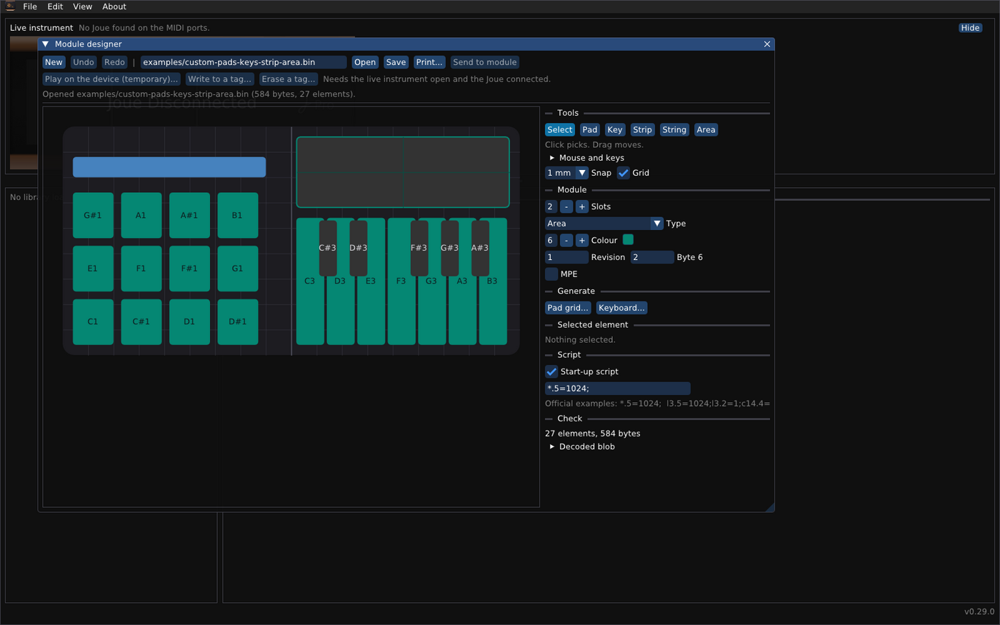

# Joué Revival: module designer guide

*English · [Français](module-designer.fr.md)*

The module designer draws the layout of a module: where its pads, keys, strips, strings and areas are, and what each sends. A layout is a small binary file (a *module blob*, at most 888 bytes) of the kind that sits on the tag of a module. This guide covers drawing it, and what you can do with it: print it at real size, try it on the instrument without any tag, write it to a blank tag, erase a tag.

Open it with **File > Module designer...** (or **View > Module designer**), or start the program with `--designer FILE`.

> [!WARNING]
> **Writing a layout to a tag and erasing a tag are lightly tested.** Try one tag first, with the other modules taken out of the instrument. A manufacturer's layout is never erased by the program.

## Contents

1. [The window](#the-window)
2. [The surface](#the-surface)
3. [Picking and moving](#picking-and-moving)
4. [The inspector](#the-inspector)
5. [Generating layouts: pad grids, keyboards, isomorphic grids, fretboards](#generating-layouts)
6. [Arranging: align, distribute, flip, repeat](#arranging-align-distribute-flip-repeat)
7. [Checking a layout](#checking-a-layout)
8. [Saving and opening](#saving-and-opening)
9. [Print at real size](#print-at-real-size)
10. [A temporary layout, without a tag](#a-temporary-layout-without-a-tag)
11. [Writing a layout to a blank tag](#writing-a-layout-to-a-blank-tag)
12. [Erasing a tag](#erasing-a-tag)
13. [What happens to each kind of tag](#what-happens-to-each-kind-of-tag)
14. [Limits](#limits)

## The window

The toolbar has two rows.

| Button | What it does |
|---|---|
| **New** | An empty layout; a small menu asks for 1 slot (90 mm), 2 slots (180 mm) or 3 slots (270 mm). |
| **Undo**, **Redo** | Every change; also Ctrl+Z and Shift+Ctrl+Z on the surface. |
| path field, **Open**, **Save** | Where the layout is kept, and the two buttons that read and write that file. |
| **Print...** | A PDF at real size. |
| **Send to module** | Not available: a layout is put on the instrument with the three buttons below. |
| **Play on the device (temporary)...** | Tries the layout on the instrument now, with no tag. |
| **Write to a tag...** | Writes it to a blank NTAG216. |
| **Erase a tag...** | Blanks a tag that holds a custom layout. |

The last three need the **Live instrument** panel open and the Joué connected; otherwise they are grey.

## The surface

The big picture is the module, seen as in the main window (mirrored). One slot is 90 mm wide and 90 mm high; a module has one, two or three slots. Millimetres are the unit everywhere: positions, sizes, snapping.

- **Snap** (1, 2, 5 or 10 mm) rounds what you draw and move. **Grid** shows a line every 10 mm and a stronger one at each slot edge.
- Overlapping elements are allowed (the black keys of a keyboard lie over the white ones). An element on a higher **Layer** is drawn on top and is picked first; the **Check** notes an overlap on the same layer, where a touch may be ambiguous.

## The designer window

The designer is a window of its own. Drag its title bar and it can leave the main window, onto another screen if you have one; dropped over the main window it goes back inside. `--single-window` keeps every window inside the main one.

## Picking and moving

The tool bar of the inspector has **Select**, **Pad**, **Key**, **Strip**, **String**, **Area**, **Button**. With **Select**, the gestures are:

| Gesture | Effect |
|---|---|
| Click | Picks one element; a click on an empty place picks nothing. |
| Drag on an empty place | Draws a selection rectangle: every element it covers is picked. |
| Ctrl-click (Cmd on a Mac) | Adds an element to the picking, or takes it out. |
| Ctrl-drag | Moves everything picked, keeping their spacing; the group stops at the edge of the surface as one piece. On an element that is not picked yet, it is picked first. On an empty place, the rectangle adds to the picks instead of replacing them. |
| Drag | Moves one element. |
| Shift-drag | Resizes, in any direction. Where you press decides what moves: near a side, that side; near a corner, both sides; in the middle, the element moves instead. With several picked, the press counts on the box around all of them, and every element is scaled with that box. |
| Shift-drag from the middle onto another element, let go | The two trade places, each keeping its size and settings. Only after at least 8 mm of travel; the other one is outlined in green; refused if one would leave the surface. |
| Alt-drag | Draws a new element of the last tool used (a pad at first), from where you press to where you let go. |
| Corner handles | Stretch the element that the inspector shows. |

A side is the outer third of the element (or of the box around the group); the cursor shows what a press would do. Everything picked is outlined in cyan and lightened; with several picked, a box with small squares shows the whole group.

With a tool other than Select, a drag on the surface draws that kind of element; a click gives it a default size.

Keys, when the pointer is over the surface:

| Key | Effect |
|---|---|
| Delete or Backspace | Removes everything picked. |
| Ctrl+D | Duplicates everything picked. |
| Ctrl+C, Ctrl+V | Copy and paste; each paste goes 4 mm further. Elements can be pasted into another layout. |
| Arrows | Move everything picked by 1 mm (Shift: 10 mm). |
| Ctrl+A, or the **Select all** button | Picks every element. |
| Escape | Picks nothing and goes back to Select. |

## The inspector

On the right, from top to bottom:

- **Tools**, **Snap**, **Grid**, and a reminder of the gestures (**Mouse and keys**).
- **Module:** **Slots** (1 to 3), **Type** (the kind of module this layout is for; the other editors recognise a layout by it, so a manufacturer's type makes them take it for that module, a Pro Area for instance; **Custom (200)** is a type that no module has, shown as an unknown module by the other editors and treated as one of yours by this program; it has not been tried on the instrument, so if the board does not accept it take a type from the list), **Colour**, **Revision**, **Tag position** (where the tag sits in the module, counted from 1 at the left, 0 counting as 1: the board says the slot in which it reads the tag, and the module starts at that slot minus this number plus one; the Pro modules have 1, the Play modules 3; for a module of two or three slots, set it to where you put the tag, and **Write to a tag...** tells you on which slots the module will sit and refuses a slot where it would not fit), **MPE**, **MPE Channels**, **Pressure range**, **Aftertouch** (see below).
- **Generate:** pad grids, keyboards, isomorphic grids and fretboards (below).
- **Arrange:** align, distribute, flip and repeat what is picked (below).
- **Selected element:** its place and size (**X**, **Y**, **Width**, **Height** in mm), **Layer**, **Z**, **Pressure range**, for a key **Y Control** (see below), **Depth** (the raw pressure byte: 40 for a pad on Low), **Options** (a hexadecimal byte), then the fields of its kind: for a pad or a key the **Note**, **Channel**, the **Velocity** range and the rest; for a strip, a string or an area the controls it sends. With several elements picked, the inspector shows the last one picked and says how many are.
- **Script:** the **Start-up script**, a text the instrument runs when the module starts. Real modules use it for vibrato, aftertouch and glissando (`l3.5=2`, for instance). Leave it off unless you know the commands; see *The start-up script* below.
- **Check:** see below.

### Parameters, as in the manufacturer's modules

The parameters have the names, the choices and the values that the main editor shows for the manufacturer's modules, and they are written where the manufacturer's modules keep them. Opening a real module in the designer shows its own values (the Scaler: MPE on, 1-16, High, Channel; its keys: Y Control on, CC 74, range 0 to 127, Natural, Absolute).

| Parameter | Where | Choices |
|---|---|---|
| **MPE** | the options byte of the module header, bit 0 | on, off |
| **MPE Channels** | the same byte, bits 4 and 5 | 1-16, 1-8, 9-16 |
| **Pressure range** (module) | the depth byte of every pad, key, string and area | Low, High; *Custom* when they differ |
| **Pressure range** (element) | its depth byte | Low, High, Custom; Low and High depend on the kind: pad 40 and 70, key 40 and 60, string 30 and 50, area 40 and 70, and 80 and 107 for the bubble of the Scaler and Grand Clavier |
| **Aftertouch** | the start-up script: `*.23=1;` (Channel) or `*.22=1;` (Polyphonic) | Off, Channel, Polyphonic |
| **Y Control** (keys, version 2) | the options of the key (bit 5 on, bit 3 relative), its CC number, its range | on or off; **CC number** 0 to 127; **Range**; **Direction** Natural or Inverted (the two ends of the range swapped); **Mode** Absolute or Relative |
| **Vibrato** and **Vibrato value** | the start-up script: `<target>.2=1;` switches it on, `<target>.5=<value>;` is its value | on or off; the value from 0 to 8192. The target is the one of the other vibrato command, or `*` |
| **Glissando** and **Glissando range** | the options of the keys (bit 7, `0x80`) and `c14.4=1;` (or `c14.4=0;`) in the script; the range is the pitch range of a **Glide** element | on or off; 2, 3, 4, 5, 7, 12, 24, 48 or 96 semitones. **Add glissando** makes the Glide for every pad and key; **Update the glissando keys** takes in the ones added since; **Remove glissando** takes it all away |
| **Button Action** (the **Button** tool) | the command text of the button | **Vibrato on/off**, **Channel selection**, **Sustain on/off**, **Bending on/off**, **YControl on/off**, **Aftertouch on/off** (channel or polyphonic), **Glissando on/off**, **Fretless on/off**, **Octave down**, **Octave up**, or a **Custom command** |
| **Channel**, **Note**, **Velocity** | the fields of the element | as in the main editor |

A **button** has an **Action**, a **Target** and, for *Channel selection*, a **Channel**. The command it writes is the one the manufacturer's buttons hold: for instance *Vibrato on/off* with the target `l3` is `l3.2^1;`. The **Target** says what the action works on: `*` every element, `l3` the elements of layer 3, `l{2,3}` layers 2 and 3, `c6` the strings, `c2` the pads, `c5` the keys. A button is drawn with a short symbol (Vib, Sus, Bend, Y, AT, Gliss, Fret, -12, +12, Ch n). An action button follows the **Pressure range** of the module (depth 40 or 70); an octave button is not pressure sensitive (depth 127), as in the real modules. The *Glissando* action works with the Glide element of the **Glissando** setting of the module. The Glide cannot be clicked on the surface (it would hide the keys it covers): it is managed with that setting. Vibrato and glissando were measured on the four real modules: all four have vibrato off and a value (1024, 1024, 2; none on the Grand Fretboard), and the Scaler and the Grand Clavier have glissando on at 48 semitones. In the original editor, switching glissando on in the Scaler also switches its vibrato off; the designer leaves both as you set them. The pads that send a control change, a program change or a pitch bend instead of a note are not in the designer yet; the start-up script can do them by hand (see *The start-up script* below). Changing **Aftertouch** keeps the target of the command when the script already has one (`l{2,3}.22=1;` stays on layers 2 and 3) and otherwise uses `*`, which is every element. All of this has been checked against the four real modules, not on an instrument.

### The start-up script

The script is a list of commands, each ending with `;`. A command is a *target*, a dot, a number, an operator and a value, for example `l3.5=1024;`. The target is `*` (every element), `l3` or `l{2,3}` (the elements of those layers) or `c6` (a kind of element: `c2` pads, `c3` strips, `c5` keys, `c6` strings, `c7` areas, `c14` the Glide). The operator `=` sets the number to the value, `^` flips the bits of the value, `+` and `-` add and subtract. The numbers used by the manufacturer's modules and buttons are: **1** channel, **2** vibrato, **3** bending (strings), **4** octave shift in notes, **5** vibrato value, **6** bending value (strings), **11** pitch range (strings), **20** options of the elements (`^32` Y control, `^128` glissando), **21** sustain, **22** polyphonic aftertouch, **23** channel aftertouch, **24** fretless (strings), and, on the Glide (`c14`), **4** glissando on or off. The meaning of a number depends on the kind of element it is sent to, and the manufacturer's scripts hold others that the designer does not interpret (`.3=74;` and `.12=64;` on the keys of the Grand Clavier, for instance). The settings of the module and the Button tool write these commands for you.

## Generating layouts

Each generator opens a small window and adds its elements to the layout, ready to be picked and edited; each can be undone.

- **Pad grid...** makes a block of pads: **Rows**, **Columns**, **Gap (mm)**, **First note**, **Row step** (how many notes a row adds), **Channel**. The grid fills the whole module, with a 4 mm margin.
- **Keyboard...** makes a piano keyboard: **White keys**, **First note** (its name is shown beside it), **Channel**. It spans the width of the module, and the black keys lie over the white ones.
- **Isomorphic grid...** makes pads whose note is *first note + column x interval + row x interval*, so that a shape is the same chord or scale wherever it is played. **Layout** gives the usual intervals: *Fourths* (+1 along a row, +5 up, as on a Linnstrument), *Fifths* (+7), *Major thirds* (+4), *Minor thirds* (+3), *Sequential* (each row continues the one before), or *Custom* (the two intervals are yours). **Stagger the rows** shifts every other row by half a pad, for a hexagonal feel.
- **Fretboard...** makes one string element per string, side by side, the lowest string at the bottom of the picture, as the Grand Fretboard has them. **Tuning**: Guitar (E A D G B E), Bass with four strings (E A D G), Violin (G D A E), Fourths (as the Grand Fretboard), or *Custom* (the number of strings, the lowest note, the interval between strings). **Frets** is the number of frets of every string, **Channel** the MIDI channel. The strings span the module except for the column on the right where the buttons of a real Grand Fretboard are.

## Arranging: align, distribute, flip, repeat

The **Arrange** section works on what is picked.

| Tool | Effect |
|---|---|
| **Align** Left, Centre, Right, Top, Middle, Bottom | Moves the picked elements onto one edge, or the middle, of the box that holds them. With **one** element it aligns to the module: for instance Centre puts it in the middle of the width. |
| **Distribute** Across, Up and down | Makes the gaps between at least **three** elements equal; the first and the last stay where they are. |
| **Flip** Left-right, Up-down | Mirrors the picked elements within the box that holds them: their places only, not their sizes or notes. Flipping twice gives the places back. |
| **Repeat...** | Makes **Copies** of the picked elements, each copy **Across** (and **Up**) a given number of millimetres further than the one before, and with the **Note step** added to the note of each copy (pads, keys and strings). It stops before a copy that would reach off the module or make the layout too big, and says how many copies it made. The copies are picked afterwards. |

Every tool is one step of **Undo**.

## Checking a layout

**Check** shows the number of elements and the size in bytes, then what it found. **Errors** (the layout cannot be put on the instrument or written to a tag until they are fixed): more than 255 elements, more than 888 bytes, an element number used twice, an element reaching beyond the surface, an element smaller than 2 mm. **Notes** (for information): no elements yet, two elements overlapping on the same layer, a glide that lists an element that does not exist. **Decoded blob** shows every record.

## Saving and opening

**Save** writes the blob to the path in the field; **Open** reads one. Before every upload the program saves the layout of the module as a file in the `module-backups` folder of its data folder (`slot1-<name>-<time>-original.bin`). That file is a module blob of your own module: opening it here shows how the manufacturer's layout is built, and it is a good starting point (change what you need and keep its structure).

## Print at real size

**Print...** saves a PDF whose page is in real millimetres: 90 mm on the module is 90 mm on the paper. Choose **A4** or **US Letter** (landscape, so three slots, 270 mm, fit), with or without **Note names**, a **10 mm grid** and **Crop marks and scale bar**.

- Print it at **100 % (actual size)**, never "fit to page".
- The bar on the sheet must measure **100 mm**: check it with a ruler.
- On Letter a three-slot module is only 4.7 mm from the sides, which most printers cannot reach; the window says so, and A4 is the better choice.
- **Save PDF and open it** opens the file in your PDF viewer.

The sheet is a template: lay it over a module, or cut it out and use it as an overlay.

## A temporary layout, without a tag

**Play on the device (temporary)...** sends the layout to the instrument as a temporary module. Nothing is written to any module, and nothing has to be on the instrument.

- It goes to **slot 1** after power-up (or to the slot of the last insertion or removal).
- It is shown in the live picture marked *(temporary)*, and you can play it on the sensor.
- It **goes away** when the instrument is reset, and as soon as the board announces a module put on or taken off in any slot (a manufacturer's module or a tag written here). **Rescan modules** does not end it.
- It is a good way to try a layout before putting it on a tag.

## Writing a layout to a blank tag

**Write to a tag...** writes the layout to a blank **NTAG216** tag (NXP, 888 bytes of user memory), so that the tag becomes a module of its own. Other chips do not fit: NTAG213 and NTAG215 are too small.

1. Take the **other modules out** of the other slots.
2. Lay the **blank** tag flat on the slot you will choose, where the tag of a module would be. A tag with other data on it (NDEF text) may be taken by the board for a module.
3. In the window choose the **slot**, tick *A blank tag is in this slot, and no module*, and press **Write the tag**.

The program refuses to write if the board reports a module in that slot, if the tag already holds a layout (it reads the tag first: a manufacturer's layout is never written over, and a custom layout has to be erased first), if it finds no tag there, or if the board does not give the full privileges that the first page of a tag needs. After writing, the slot is read back and compared. The module then appears in the live picture, and **Edit** works on it.

**A new NTAG216 is not empty.** From the factory its first page holds the empty NDEF message (`03 00 FE 00`); a tag that a phone has formatted may hold an empty record instead (`03 03 D0 00 00 FE`). The board reads that first byte as the type of a module, so a new tag shows up as *Bubbles*. The program recognises it from what is on the tag, and treats it as blank: the slot shows no module, **Write to a tag...** is allowed, and **Erase a tag...** says it is already blank. In the Detection log the announcement says *Bubbles or a new tag*, and once the tag is read the log says *a new tag, not a module* with the first bytes it read. A tag that holds other data, such as a text written with a phone, is not taken for a new one: blank it with an NFC app first.

## Erasing a tag

**Erase a tag...** blanks the tag in a slot, **only if it holds a custom layout**. The window says so in red.

- A layout is **a manufacturer's** when its type is known and its records are those of the factory layout (whatever settings were changed in it): never erased. A type the program does not know is refused too, since it may be a manufacturer's.
- A layout is **custom** when its type is known and its records are not the factory ones (a layout drawn in the designer): it can be erased.
- The tag is read twice and must give the same result, and its type must be the one the board announced for the slot (a read of a slot can return another slot's module). Take the other modules out first.
- A tag written from a copy of a factory layout counts as a manufacturer's and cannot be erased here: the rule is deliberately on the cautious side.

## What happens to each kind of tag

Both windows (**Write to a tag...** and **Erase a tag...**) tell you what is in the slot you chose **before** you press anything, in a line that is red when the action is not possible: *Slot 1 holds a Scaler, a manufacturer's module. It cannot be overwritten: its layout would be lost. Take it out to write a tag here.* The button stays grey in that case. If the program still has to refuse (the board answered differently from what the live window shows, for instance), the answer under the buttons has three parts: a red line saying **what could not be done**, **why**, and **what to do instead**.

| What is in the slot | **Write to a tag...** | **Erase a tag...** | **Edit** and **Upload to Joué** | **Restore** |
|---|---|---|---|---|
| A **manufacturer's module** (Pads, Grand Clavier, Scaler, Grand Fretboard, Play...) | Refused: the board reports a module, and the tag is read first (*holds a manufacturer layout*). | Refused (*holds a manufacturer layout*). | Allowed: only the settings you changed are written; the layout, type and colour stay; the original is saved to a file first and the result is read back. | Writes the saved layout back. |
| A tag **written from a copy of a factory layout** | Refused, as above. | Refused: counts as a manufacturer's. | Allowed, as above. | Writes the saved layout back. |
| A **custom tag** (a layout drawn in the designer) | Refused (*already holds a layout, erase it first*). | **Allowed**: red warning, the tag is read twice, its type must be the one the board announced. | **Opens in the module designer** (its records are not those of a factory layout): the original is saved to a file first, and **Save** writes a separate `-edited.bin` file; to put the result on the tag, erase it then write it. | Not applicable. |
| A tag with a layout of a **type the program does not know** | Refused. | Refused: it may be a manufacturer's. | Opens in the module designer when its layout can be read; otherwise not available. | Not applicable. |
| A **blank** tag, or a **new** one (it reads as a Pro Bubbles of version 0) | **Allowed**: the tag is detected, the board gives the full privileges, the layout is written and read back. | Nothing to do: *already blank*. | Nothing to edit. | Not applicable. |
| **No tag** in the slot | Refused (*no tag is detected*). | Refused (*no tag is detected*). | Nothing to edit. | Not applicable. |
| The board **answers for another slot** (other modules are in the other slots) | Refused when the answer is a layout; take the other modules out and try again. | Refused when the type is not the announced one. | The read of a slot is checked against the announcement. | Checked against the module that was read. |

To **replace** a custom tag with another layout: **Erase a tag...**, then **Write to a tag...**. A manufacturer's module is never replaced by a different layout; its settings can be changed with **Edit**. The **temporary layout** never writes to any tag.

When the program cannot tell, it refuses: a refusal changes nothing, and the message says why. A tag the board does not answer for at all (what a blank tag may do) is treated as blank, because there is nothing to read; the board's own announcement of a module in the slot still blocks the write. Writing and erasing tags have been tried on very few real tags.

## Limits

- At most **888 bytes** and **255 elements** per layout; up to **3 slots** of 90 x 90 mm.
- The designer makes layouts; it does not know every setting of every module. Settings it cannot show are left as the layout has them.
- Writing and erasing tags, and the temporary layout, have been tried on very few tags and on one instrument. Play modules and the Synth are known only from the official templates.
- **Send to module** (writing a layout straight into a module that is in the instrument) is not available; use a blank tag or the temporary layout.

## Troubleshooting

| Problem | What to do |
|---|---|
| The three instrument buttons are grey | Open the Live instrument panel and connect the Joué. |
| *Not written: ... no tag* | Lay the tag flat on the slot's reader; try another spot; check it is an NTAG216. |
| *Not written: the board reports a module* | Take the module out of that slot. |
| The temporary layout vanished | A module was put on or taken off, or the instrument was reset: send it again. |
| The printed bar is not 100 mm | The printer scaled the page: print at 100 % (actual size). |
